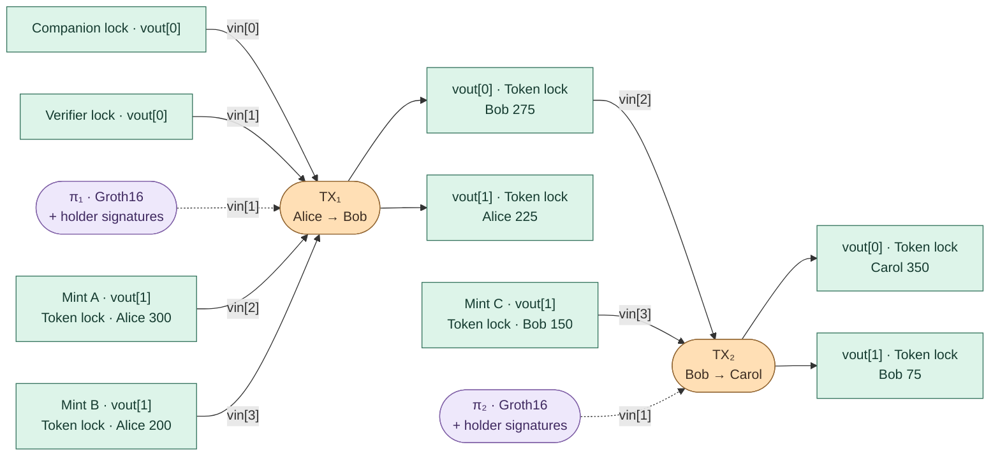

# 4thGraph

**English** · [简体中文](README.zh-CN.md)

> **Write Bitcoin contracts in Forth, from the first locked output to the final spend.**

4thGraph is a contract description language (SDL) and toolchain for BSV. Use it to define spending conditions, carry state in UTXOs, build transactions that depend on one another, and verify an off-chain computation with a zero-knowledge proof.

**[Start with an Agent](#start-with-agent)** · [Runnable projects](#project-index) · [Wallet SDK](sdk/README.md) · [Docs](docs/README.md) · [Results](#results)

---

<a name="why-4thgraph"></a>

## Why develop across the whole transaction chain?

Script builders usually tell you whether a given witness satisfies a lock. A token wallet also has to follow the money across spends. How can the 275 tokens Alice pays Bob become a valid input to his next payment, while both transfers preserve the total supply?

### Two connected token payments

Follow the **solid arrows** from the output (`vout`) that creates a coin to the input (`vin`) that spends it. **Dashed arrows** show where the Groth16 proof and holder signatures enter each verifier input.



> **Follow Bob’s 275 tokens.** Alice spends 300 and 200 to pay Bob 275 and take 225 in change. Bob spends `TX₁.vout[0]` at `TX₂.vin[2]` and adds another 150 to pay Carol 350 and take 75 in change.

Each payment uses fresh companion and verifier outputs. The diagram expands that pair for the first payment. The token locks require the settlement to spend a designated companion output. The companion lock checks which verifier the settlement actually spends. That verifier checks the proof and signatures supplied at `vin[1]`, binding conservation and authorization to the actual inputs and outputs.

---

<a name="start-with-agent"></a><a name="start-with-ai"></a><a name="pels-counter"></a>

## Start with an Agent

Open this checkout in Codex or another coding agent that can edit files and run commands. Give it this prompt.

```text
Read skills/4thgraph/SKILL.md. Use PELS Counter to build a counter starting at 0.
Each spend must add one and keep the same rule in exactly one successor output.
Save the source in the project workspace, build the full lock, and give me a command to rerun.
If regtest is available, demonstrate 0 → 1 → 2, then try jumping directly from 0 to 2.
```

> [!TIP]
> **Check the result**
>
> Inspect the Forth rule and the full lock. On regtest, both increments should be mined. BSV Node and chain-gang should both reject a spend that jumps directly from 0 to 2. [Counter source and replay](projects/pels-counter/README.md)

<a name="4thg-quickstart"></a>

[Manual setup for the CLI and Agent skill](docs/install.md)

<a name="capabilities"></a><a name="project-index"></a><a name="p2pkh-example"></a><a name="p2pk-example"></a>

## Choose a project to build on

| Development goal | Where to start |
| --- | --- |
| Make a payment and connect a signer | Build a native P2PK or P2PKH lock and a signed transaction. Use the same wallet interface from TypeScript, Rust, Go, or Python. [Payment scripts](projects/p2pk-p2pkh-baseline/forth/README.md) · [Wallet SDK](sdk/README.md#quickstart) |
| Carry state across spends | Change the counter’s transition and see how a wrong count, amount, or successor script causes a spend to fail. [PELS Counter](projects/pels-counter/README.md) |
| Let participants submit independently and settle together | Declare branches and a join in Forth. Compare the transactions, signatures, and bytes required for joint and independent submission. [Workflow examples](projects/workflow-examples/README.md) |
| Prove a computation off-chain | Generate Script or Circom from a supported state relation. With matching setup artifacts and a witness, generate a Groth16 proof and check its binding to the spend. [Proof counter](projects/proof-counter/README.md) · [Groth16 verifier](docs/groth16-bls12-381.md) |

[Browse all projects](projects/README.md)

<a name="results"></a><a name="4thg-comparisons"></a><a name="transaction-costs"></a>

## Measured on real transactions

- **What does optimizing a lock save on a payment?** From v0.5.0 to v0.6.0, the P2PKH-R1 compiler experiment reduced a two-input, two-output BIP143 ALL payment from 84,212 B to **83,498 B** and an OTDA ALL payment from 95,282 B to **94,864 B**. [P2PKH-R1 results](projects/p2pkh-r1/README.md#measured-results)
- **What does it cost to verify a proof on-chain?** For the same BLS12-381 Groth16 proof and fixed public inputs, deployment plus one spend totaled **280,731 bytes** with 4thGraph and **393,553 bytes** with the tested nChain configuration. Both spends were mined on BSV regtest. [Experiment, raw results, and transaction IDs](projects/proof-counter/experiments/fixed-statement/README.md)

[All project results](showcase/README.md) · [Detailed wallet transaction costs](docs/benchmark.md#transaction-costs)

In these comparisons, **BIP143 / OTDA** names the two BSV signature digest formats. Both set `SIGHASH_FORKID` (`0x40`). The BSV BIP143 format uses hashed transaction components, while Chronicle OTDA adds the `0x20` bit and uses the original transaction digest algorithm. [BIP143](https://github.com/bitcoin/bips/blob/master/bip-0143.mediawiki) · [Chronicle](https://docs.bsvblockchain.org/network-topology/nodes/sv-node/chronicle-release)

<a name="architecture"></a><a name="toolchain"></a>

## Toolchain architecture

| Layer | What you write and what you get |
| --- | --- |
| **Language and standard library** | Typed Forth words express computations. Contract declarations describe roles, transaction dependencies, and state transitions. The compiler checks stack effects and numeric ranges. [SDL specification](docs/language/specification.md) · [Syntax](docs/language/syntax.md) · [Standard library](docs/language/stdlib.md) |
| **Compiler and planner** | The compiler emits BSV Script. The planner compares eligible transaction layouts and their costs. For supported relations, the proof backend builds circuits and verifiers. [Toolchain guide](docs/toolchain.md) |
| **Runtime and verification** | The runtime binds real parent outputs, requests signatures, and assembles witnesses. Replay reports connect a build to the actual transactions and the verdicts from BSV Node and chain-gang. [Repository layout](docs/repository-layout.md) · [Replay workflow](docs/toolchain.md#复放与编译) |

**Recursive proofs are a research direction.** The token transfers above check direct parent outputs and the current transition at each spend. A recursive construction would also verify a predecessor proof inside the next proof and bind its authenticated state to the output being spent. [Verification paths available today](docs/language/stdlib.md#验证路径)

---

## License

4thGraph is available under the [MIT License](LICENSE).
