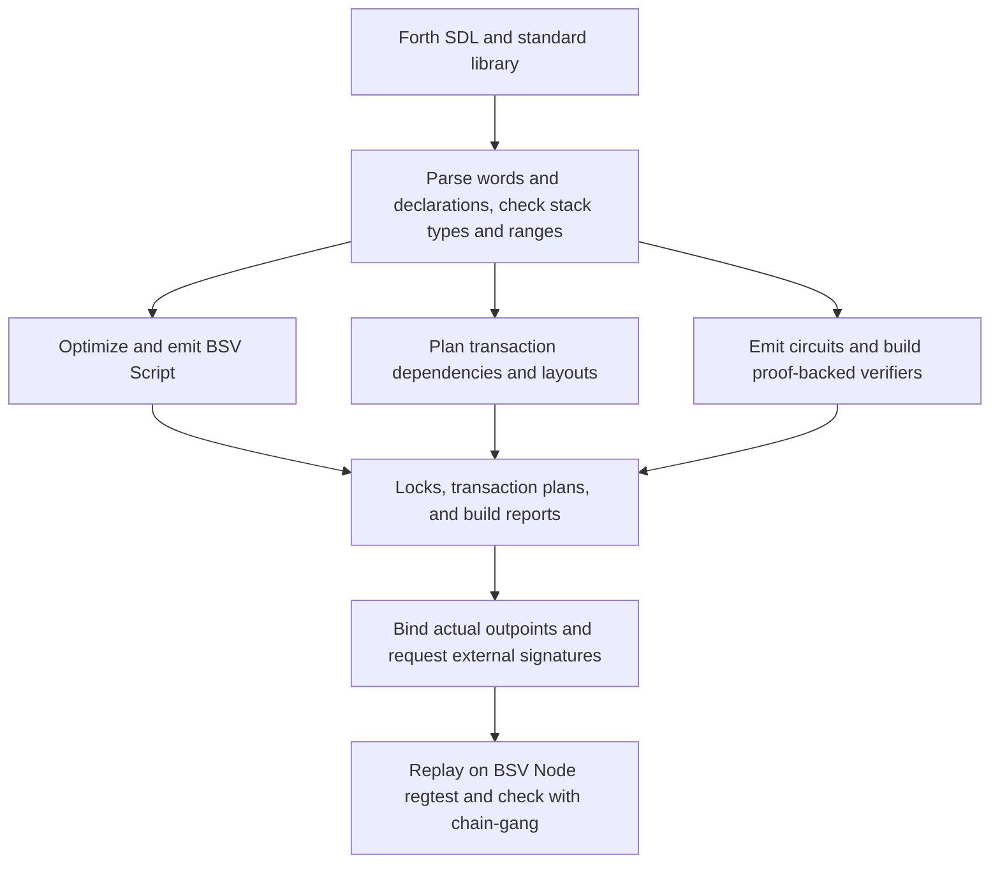

# 4thGraph

**English** · [简体中文](README.zh-CN.md)

4thGraph helps developers build, optimize, and verify BSV locking scripts and multi-transaction workflows from Forth source using a reproducible toolchain. It includes a Forth-based SDL, compiler, and standard library for generating Script, transaction plans, and Circom circuits for supported relations. The repository also offers runnable contract and wallet projects, regtest replays and benchmarks, a wallet SDK for TypeScript, Rust, Go, and Python, and a Codex skill for authoring Forth and reviewing build outputs.

[Why 4thGraph](#why-4thgraph) · [Architecture](#architecture) · [Quickstart](#4thg-quickstart) · [SDL documentation](docs/language/README.md) · [Projects](projects/README.md) · [Results](showcase/README.md) · [Wallet SDK quickstart](sdk/README.md#quickstart)

<a name="why-4thgraph"></a>

## Why 4thGraph?

A BSV contract needs both rules for each spend and a plan for how spends depend on one another. If two branches can obtain their data and signatures together, they may fit in a single transaction. If each participant must submit independently, the plan needs intermediate UTXOs and a later spend to join their results. That choice changes the locks, witnesses, and cost of the complete path. 4thGraph puts computation and transaction constraints in the same source so developers can build and replay eligible layouts from the same rules. [Workflow examples](projects/workflow-examples/README.md)

### What sets it apart

- **Typed Forth with inspectable optimizations.** Stack effects and numeric ranges let the compiler check definitions and justify Script rewrites. Build reports include the source locations, conditions, and byte changes behind those rewrites. [SDL specification](docs/language/specification.md)
- **Transaction boundaries are a build decision.** For supported workflows, 4thGraph compares fused and split layouts against input and signer availability and independent submission requirements. It reports which candidates qualify, estimates their costs, and exports an ordered transaction graph. [Candidate search and transaction graphs](docs/toolchain.md)
- **One state relation can use different verification paths.** A supported `relation:` can use direct Script or a proof-backed path, depending on policy and available proving inputs. The generated lock ties the chosen path to the actual spend and its successor outputs. [Verification paths](docs/language/stdlib.md#验证路径)

## Architecture



The compiler and backends live in `src/fourthgraph/` with the bundled Forth standard library. The transaction runtime turns symbolic output references into actual outpoints before requesting signatures. Replay reports tie recorded transactions, engine verdicts, and block inclusion back to the selected build. The runnable projects provide the source, fixtures, and commands to reproduce those results. [Repository layout](docs/repository-layout.md) · [Build and replay guide](docs/toolchain.md) · [Results](showcase/README.md)

<a name="4thg-quickstart"></a>

## Try 4thG

Use Python 3.11 or later. From the root of a 4thGraph checkout, install the CLI into the local workspace and compile the PELS counter's increment word.

```sh
bash tools/setup-workspaces.sh
python3 tools/install.py --prefix workspace/toolchain
workspace/toolchain/bin/4thgraph projects/pels-counter/pels-counter.fth \
  --entry advance --optimize safe
```

The JSON result shows the `advance` entry, the `std/u32` import, and the eight-byte Script fragment. Continue to the full counter lock or choose another example. [Installation guide](docs/install.md) · [PELS Counter](#pels-counter) · [P2PKH](#p2pkh-example) · [P2PK](#p2pk-example)

<a name="pels-counter"></a>

### PELS Counter

Start at `0`. Every spend increments the counter and puts the same rules in the next output.

The Forth transition imports the standard library's `u32-inc` word. The complete example adds the checks that bind it to the next transaction output. [Forth source](projects/pels-counter/pels-counter.fth)

```forth
REQUIRE stdlib/u32.fth
: advance ( u32 -- u32 ) u32-inc ;
```

```sh
export PYTHONPATH=src:.
counter=projects/pels-counter/pels_counter.py
python3 "$counter" build
```

The command prints the full lock as `script_hex`. Building uses the Python standard library.

To spend and verify on Linux x86-64, use `curl`, Rust/Cargo, and a C toolchain to run the funded replay.

```sh
python3 -m venv workspace/venv
. workspace/venv/bin/activate
python -m pip install ecdsa -r tools/requirements-chronicle.txt

bash tools/verify_node.sh --profile default -- python "$counter" replay \
  --output projects/pels-counter/workspace/build/pels-counter.json
```

The replay funds `0` and mines `0 → 1 → 2`, deducting **1,000 sat per spend**. Open the JSON report to see both engines' verdicts and the mined blocks. To construct an individual spend, use `spend --parent` with the raw parent transaction. [Spend and verification guide](projects/pels-counter/README.md#spend-and-verify-on-regtest)

<a name="p2pkh-example"></a>

<details>
<summary>P2PKH · 25-byte lock</summary>

```sh
python3 projects/p2pk-p2pkh-baseline/forth/payments.py --hash160 751e76e8199196d454941c45d1b3a323f1433bd6
```

The lock commits to a public-key hash. To spend, push the signature and public key. [Forth source](projects/p2pk-p2pkh-baseline/forth/p2pkh.fth) · [Signed transaction examples](projects/p2pk-p2pkh-baseline/README.md)

</details>

<a name="p2pk-example"></a>

<details>
<summary>P2PK · 35-byte lock</summary>

```sh
python3 projects/p2pk-p2pkh-baseline/forth/payments.py --public-key 0279be667ef9dcbbac55a06295ce870b07029bfcdb2dce28d959f2815b16f81798
```

The lock contains the compressed public key. To spend, push the signature. [Forth source](projects/p2pk-p2pkh-baseline/forth/p2pk.fth) · [Signed transaction examples](projects/p2pk-p2pkh-baseline/README.md)

</details>

<a name="toolchain"></a>

## Toolchain and SDL

The compiler checks stack effects and numeric ranges, optimizes Script, and compares eligible transaction layouts. `4thgraph-circuit` emits Circom for supported relations, `4thgraph-verify` builds verification paths, and `4thgraph-report` summarizes compiler decisions and recorded replays. [Toolchain guide](docs/toolchain.md) · [Language specification](docs/language/specification.md) · [Standard library](docs/language/stdlib.md)

Install the Codex skill to author Forth, compare compiler outputs, and review replay evidence. The repository layout shows where to find the toolchain, per-project workspaces, and results. [Codex skill](skills/4thgraph/SKILL.md) · [Skill installation](docs/install.md#codex-agent-skill) · [Repository layout](docs/repository-layout.md)

<a name="4thg-comparisons"></a>

## Projects built and compared with 4thG

| Project | What the comparison shows |
| --- | --- |
| P2PKH-R1 Forth v0.3.0 experiment | The Forth baseline reproduces the v0.2.0 lock byte for byte. The optimized lock goes from 46,302 to **45,776 B**, and the two-input, two-output ForkID ALL payment goes from 93,374 to **92,322 B**. The replay also covers OTDA and a build that uses sCrypt-compiled curve kernels. [Experiment and replay](projects/p2pkh-r1/experiments/forth) |
| [BLS12-381 Groth16 verifier](docs/groth16-bls12-381.md) (in development) | Forth defines the verification stages for off-chain proofs with fixed, mixed, or spend-time public inputs. The [fixed-statement comparison](projects/proof-counter/experiments/fixed-statement/README.md) uses the same proof and public statement for 4thGraph and nChain. |

<a name="project-index"></a>

## Wallet projects

The wallet projects give teams recognizable locking templates, a shared SDK for external signers, and complete signed transactions they can replay. They cover ordinary payments, integration with P-256 and SM2 signers, deferred activation, and experiments with one-time and post-quantum signatures.

| Project | Where it fits | Integration decision | Version | Wallet SDK |
| --- | --- | --- | --- | --- |
| [Native P2PK and P2PKH](projects/p2pk-p2pkh-baseline/README.md) | A first wallet integration, ordinary secp256k1 payments, or a cost baseline | Choose whether the output carries a public key or its hash | v0.1 development | [Integration guide](projects/p2pk-p2pkh-baseline/docs/sdk.en.md#quickstart) |
| [P2PKH-R1](projects/p2pkh-r1/README.md) | Connect an existing P-256 signing device or service, or compare Forth-compiled locks | Verify the signing mode and keep persistent P-256 nonce history | [v0.3.0 Forth experiment](projects/p2pkh-r1/README.md#version-history) | [v0.2.0 SDK guide](projects/p2pkh-r1/docs/sdk.en.md#quickstart) |
| [P2PKH-R1-Deferred](projects/p2pkh-r1-deferred/README.md) | Receive funds into short locks when a separate activation can wait | Budget a fee-paying input and a second step to create the full R1 output | v0.2.0 development | [Integration guide](projects/p2pkh-r1-deferred/docs/sdk.en.md#quickstart) |
| [P2PKH-SM2](projects/p2pkh-sm2/README.md) | Integrate an SM2 signer or a GB/T 35275-2026 SignedData provider, or reconstruct eligible OTDA outputs | Match the SM2 message and user ID, and bind the expected signer identity for SignedData | v1.1.0 candidate | [Integration guide](projects/p2pkh-sm2/docs/sdk.en.md#quickstart) |
| [P2PKH-Schnorr](projects/p2pkh-schnorr/README.md) | Pay to a BIP340 x-only public-key hash or a MuSig2 aggregate key | Use a BIP340 external signer and the 4thGraph-compiled template | v0.6.0 candidate | [Integration guide](projects/p2pkh-schnorr/docs/sdk.en.md#quickstart) |
| [Lamport OTS](projects/lamport-ots/README.md) | Compare the cost of SHA-256 one-time signatures with full-key and committed-key locks | Reserve a fresh key per UTXO and choose between cheaper funding and cheaper inputs | v0.1 development | [Integration guide](projects/lamport-ots/docs/sdk.en.md#quickstart) |
| [WOTS+](projects/wots-plus/README.md) | A SHA-256 one-time-signature experiment with a smaller signature and several receive templates | Manage one-time keys and compare cached output code and OTDA reconstruction | v0.1 development | [Integration guide](projects/wots-plus/docs/sdk.en.md#quickstart) |
| [Pure ML-DSA-44](projects/ml-dsa/README.md) | A FIPS 204 interoperability or large-script experiment | Use a Pure ML-DSA-44 signer and validate relay and mining policy for large locks | v0.1 development | [Integration guide](projects/ml-dsa/docs/sdk.en.md#quickstart) |

Start with native P2PKH to run your first payment. The unified SDK uses the same wallet workflow in TypeScript, Rust, Go, and Python. Follow a project guide to connect your signer, choose a template, and replay the appropriate payment or activation. [Wallet SDK quickstart](sdk/README.md)

<a name="transaction-costs"></a>

## Compare transaction costs

P2PKH-R1's two-input, two-output ForkID ALL payments measure **119,934 B** in v0.1.0, **93,374 B** in v0.2.0, and **92,322 B** in the Forth v0.3.0 experiment. Deferred uses a **1,435 B** deposit lock and creates the **46,302 B** R1 v0.2.0 lock at activation. [R1 measurements](projects/p2pkh-r1/README.md#complete-transactions-and-stack-measurements) · [Deferred measurements](projects/p2pkh-r1-deferred/README.md)

The unified benchmark measured **260 complete transactions** across seven projects and 32 template and sighash combinations at commit `beeb4dd`. Additional mixed-output and paired `SINGLE` replays measured 88 transactions across 11 combinations. The Deferred v0.2.0 row uses the rerun at `9c5603d`. The R1 Forth v0.3.0 row comes from its funded regtest comparison. [R1 Forth replay](projects/p2pkh-r1/README.md#forth-experiment)

| Project and measured version | Inputs × outputs | Prevout lock | ForkID ALL unlock | ForkID ALL tx | OTDA ALL tx | ForkID ALL peak stack payload |
| --- | ---: | ---: | ---: | ---: | ---: | ---: |
| Native P2PKH | 2 × 2 | 25 | 107 | 374 | 374 | 145 |
| P2PKH-R1 v0.2.0 | 2 × 2 | 46,302 | 326 | 93,374 | 101,250 | 3,479 |
| P2PKH-R1 Forth v0.3.0 experiment | 2 × 2 | 45,776 | 326 | 92,322 | 100,192 | 3,478 |
| P2PKH-R1-Deferred activation | 3 × 2 | 1,435 | 197 | 93,259 | 93,260 | 359 |
| P2PKH-SM2 v1.1.0 candidate | 2 × 2 | 144,925 | 291 | 290,554 | 316,018 | 4,147 |
| Lamport OTS, committed key | 2 × 2 | 7,746 | 16,549 | 48,708 | 79,616 | 16,707 |
| WOTS+, cached steps with reconstruction | 2 × 2 | 33,956 | 2,310 | 72,650 | 79,090 | 2,701 |
| Pure ML-DSA-44 | 2 × 2 | 926,412 | 2,588 | 1,858,122 | 5,563,725 | — |

All sizes are in bytes. Lock, unlock, and stack measurements use the first ForkID ALL input. Peak stack payload is the local evaluator's peak combined data size on the main and alternate stacks. Deferred activation includes a fee-sponsor input. ML-DSA-44 stack data is unavailable. Each project README has the per-input and per-output measurements, the cost of adding an input or output, and the lifecycle totals.

The OTDA ALL measurements for R1 v0.2.0 and cached-steps WOTS+ use explicit reconstruction.

The SM2 candidate uses locking template `1` from v1.0.0 and automatically selects a shorter OTDA unlocking script when available. In the measured OTDA ALL transaction, reconstruction reduces the unlock from 290,109 to 13,023 bytes per input. The complete transaction drops from 870,194 to 316,018 bytes, a 63.7% reduction. [SM2 reconstruction results](projects/p2pkh-sm2/README.md#otda-constructor)

## Reproduce the results

The benchmark guide shows how to replay signed transactions against BSV Node 1.2.3 and the pinned chain-gang version. Each project links its protocol specification, security analysis, acceptance cases, and SDK. [Benchmark guide](docs/benchmark.md)
