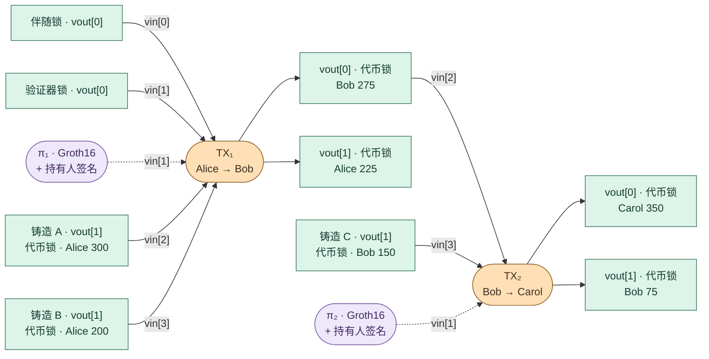

# 4thGraph

[English](README.md) · **简体中文**

**用 Forth 写比特币合约，让应用状态随交易延续。** 4thGraph 是面向 BSV 的合约描述语言（SDL）和工具链。你可以在同一个项目里定义花费条件、管理 UTXO 状态、构建相互依赖的交易，并为适合在链下完成的计算生成零知识证明，在链上验证结果。

<a name="why-4thgraph"></a>

## 为什么从整条交易链开始？

脚本构建工具通常关注一笔花费，检查解锁数据能否满足这把锁。开发代币钱包还得追踪一连串花费。Alice 付给 Bob 的 275 枚代币，怎样才能成为 Bob 下一笔付款的有效输入，同时保证两次转账都没有凭空增加代币？

下面是开发中的 Token 合约里两笔相连的付款。沿**实线**可以追踪一枚代币从哪个输出（`vout`）产生，又被哪个输入（`vin`）花费。**虚线**标出链下证明和持有人签名进入验证器输入的位置。



跟着 Bob 的 **275** 读这张图。Alice 花费两枚代币输出（300 和 200），创建锁给 Bob 的 275 和找给自己的 225。Bob 随后用 `TX₂.vin[2]` 引用 `TX₁.vout[0]`，再花费另一枚 150，付给 Carol 350，找回 75。两笔付款各用一对新的伴随输出和验证器输出，图中在第一笔展开这对锁。

代币锁要求本次花费同时消费规定的伴随输出。伴随锁核对实际花费的验证器，验证器用 `vin[1]` 提供的证明和签名检查这笔转账，把数量守恒和授权绑定到实际输入、输出。

<a name="start-with-agent"></a><a name="start-with-ai"></a><a name="pels-counter"></a>

## 用 Agent 开始

在 Codex 等能读写文件、运行命令的编程 Agent 中打开这个仓库，把下面的话发给它。

```text
读 skills/4thgraph/SKILL.md，用 PELS Counter 写一个从 0 开始的计数器。
每笔花费只能加一，唯一的后继输出必须保留同一条规则。
用项目工作区保存源码，编译完整锁，给我一条可复跑的命令。
如果能运行 regtest，演示 0 → 1 → 2，再试一次从 0 直接跳到 2。
```

**怎样判断写对了？** 先看 Agent 生成的 Forth 规则和完整锁。运行 regtest 后，报告应显示两笔加一交易入块，而 BSV Node 和 chain-gang 都拒绝跳过一步的花费。[计数器源码与复放](projects/pels-counter/README.md)

<a name="4thg-quickstart"></a>

[手工配置 CLI 与 Agent skill](docs/install.md)

<a name="capabilities"></a><a name="project-index"></a><a name="p2pkh-example"></a><a name="p2pk-example"></a>

## 按开发目标选择项目

| 我想做什么 | 可以从这里开始 |
| --- | --- |
| 构建付款、接入签名器 | 用原生 P2PK 或 P2PKH 生成锁和签名交易，再从 TypeScript、Rust、Go 或 Python 调用同一套钱包接口。[付款脚本](projects/p2pk-p2pkh-baseline/forth/README.md) · [钱包 SDK](sdk/README.zh-CN.md#quickstart) |
| 让状态跨交易延续 | 修改计数器的状态转换，观察错误的计数、金额或后继脚本怎样使花费失败。[PELS Counter](projects/pels-counter/README.md) |
| 让参与者分别提交、最后结算 | 在同一份 Forth 里声明分支和汇合，比较一次提交与分笔提交所需的交易、签名和字节数。[工作流示例](projects/workflow-examples/README.md) |
| 为计算生成零知识证明 | 从同一份受支持的状态关系生成 Script 或 Circom，使用匹配的设置文件和见证生成 Groth16 证明，再验证它与实际花费的绑定。[证明计数器](projects/proof-counter/README.md) · [Groth16 验证器](docs/groth16-bls12-381.md) |

[浏览全部项目](projects/README.md)

<a name="results"></a><a name="4thg-comparisons"></a><a name="transaction-costs"></a>

## 从实测看构建结果

- **脚本优化省下多少交易字节？** P2PKH-R1 的 Forth 基线逐字节复现了 46,302 字节的参考锁。优化后锁为 **45,776 字节**，同一两进两出 ForkID ALL 付款从 93,374 降到 **92,322 字节**。[源码、对照与复放](projects/p2pkh-r1/experiments/forth/README.md)
- **链上验证一份证明要付出多少成本？** 在同一份 BLS12-381 Groth16 证明、同一组固定公开输入下，4thGraph 的部署加一次花费共 **280,731 字节**，受测 nChain 配置为 **393,553 字节**。两种花费都在 BSV regtest 入块。[实验条件、原始数据与交易 ID](projects/proof-counter/experiments/fixed-statement/README.md)

[全部项目成果](showcase/README.md) · [钱包交易成本明细](docs/benchmark.zh-CN.md#transaction-costs)

<a name="architecture"></a><a name="toolchain"></a>

## 工具链架构

| 层次 | 开发者写什么，工具交付什么 |
| --- | --- |
| **语言与标准库** | 用带类型的 Forth 词描述计算，用合约声明描述参与角色、交易依赖和状态转换。编译器检查栈效果和数值范围。[SDL 规范](docs/language/specification.md) · [语法](docs/language/syntax.md) · [标准库](docs/language/stdlib.md) |
| **编译与规划** | 编译器生成 BSV Script，规划器比较满足约束的交易布局及成本。证明后端为支持的关系生成电路和验证器。[工具链手册](docs/toolchain.md) |
| **运行与验证** | 运行器绑定实际父输出、请求签名并组装见证。复放报告把构建产物与实际交易、BSV Node 和 chain-gang 的判定对应起来。[仓库目录](docs/repository-layout.md) · [复放流程](docs/toolchain.md#复放与编译) |

**递归证明是研究方向。** 上图的 Token 转账逐笔验证直接父输出与本次状态转换。递归方案还要在新证明中核验前序证明，并把前序证明认证的状态绑定到本次实际花费的输出。[当前工具链支持的验证路径](docs/language/stdlib.md#验证路径)
