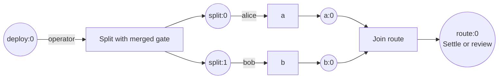

# 4thGraph documentation

[简体中文](README.zh-CN.md) · [4thGraph](../README.md)

4thGraph puts **Forth rules, UTXO transaction plans, and verification policies** in one build workflow. You describe how state moves, who must authorize each step, and which steps can be submitted independently. The toolchain produces locks and transaction plans, then measures the results with replayable transactions.

[Why Forth](#why-forth) · [CPN transaction plans](#cpn) · [Verification and recursive proofs](#verification) · [Automate builds and measurements](#build-and-measure) · [Documentation index](#documentation-index)

<a name="why-forth"></a>

## Why Forth

Forth and Bitcoin Script both pass values on a stack. Forth gives those operations names so that a state transition or signature check can become a reusable word. 4thGraph uses Forth 2012 Core as its semantic baseline and compiles a subset amenable to static checking. The stack effect `advance ( u32 -- u32 )` makes the 32-bit input and output explicit. The compiler checks calls, branch joins, and numeric ranges, then uses those facts to remove provably redundant operations and reduce stack shuffling. It can also compile supported relation words into circuit constraints. [Language specification](language/specification.md) · [Counter source](../projects/proof-counter/counter.fth)

<a name="cpn"></a>

## How a CPN describes transactions

A CPN is a Colored Petri Net. 4thGraph builds a stage dependency graph from Forth declarations and lowers the chosen transaction layout into a CPN plan. The plan refers to outputs by `step:vout`. Once the parent transaction bytes are known, the runtime binds the actual `txid:vout` and prepares signing requests. [Transaction graph specification](language/specification.md#交易图)

| CPN concept | What it represents in 4thGraph |
| --- | --- |
| Place | A logical output slot. Work outputs, results, state, and receipts have distinct types. |
| Token | An actual spendable output at a place, with its outpoint, amount, locking script, and deployment root. |
| Transition | A transaction that consumes specified inputs and creates ordered outputs. The plan records the stages, signing roles, witnesses, and transaction field constraints. |
| Marking | The live outputs supplied by the runtime. The CPN checks combine them with available witnesses, signing roles, and block height to list ready steps or missing prerequisites. |

These are the two spendable branches of a split in the gated parallel example. Alice and Bob each spend one work output. The join checks that both results come from the same split and consumes them in the order `a:0`, `b:0`.



If the contract declares a timeout refund, the ordinary path and the refund can compete to spend the same output. The node checks the actual UTXO set and executes Script to decide whether the spend succeeds. Use `--cpn` to draw the chosen plan in Mermaid or `--cpn-plan` to export its canonical encoding. The build records its digest as `plan_sha256`. One plan describes a finite execution. A long-running contract passes state to the next spend in a successor UTXO. [Executable transaction graph and examples](toolchain.md#可执行交易图) · [Timeout recovery](toolchain.md#超时退出)

<a name="verification"></a>

## Verification compilation and recursive zero-knowledge proofs

**Transaction compilation determines where each output is spent. Verification compilation determines what evidence makes that spend valid.** For a supported `relation:`, the verifier planner can compare direct Script, transparent R1CS with a public assignment, and Groth16 with a matching circuit and setup. Each path must enforce the state transition and successor outputs. Proof-based paths also bind public signals to the actual spend so a valid proof cannot be substituted for another set of inputs or outputs. Keeping data private also requires defining which values stay in the witness and which commitments or results must be public. [Verification paths and build requirements](language/stdlib.md#verification-paths) · [Groth16 verifier](groth16-bls12-381.md)

Recursive proofs address applications that must **authenticate the origin of each new state as its history grows**. The existing serial example carries prior transaction bytes and traces them back to the deployment root. Its witness grows with the number of stages. A recursive construction would start from a trusted initial state or issuance anchor. The next proof would verify the preceding proof and the current transition, with the authenticated previous state bound to the input being spent and the next state constrained. A verifier could check the accumulated history relation with one proof. Measuring proving cost and on-chain verification requires the actual circuit. Node-validated chain state still determines whether the transaction is included and whether the output remains spendable. [Current serial verification](language/specification.md#交易声明) · [Proof counter](../projects/proof-counter/README.md)

The toolchain supports proof builds for bounded state relations today. **Recursive proofs and joint selection across stages remain research.** The goal is to search transaction boundaries and per-stage verification backends together, satisfy authorization, data availability, and privacy requirements, then compare proof size, proving time, total transaction bytes, and confirmation dependencies. [Roadmap](toolchain.md#路线图)

<a name="build-and-measure"></a>

## Generate scaffolding, replay, and measure

The same contract rules can generate candidates, test transactions, and reports, so a developer can compare two builds under the same conditions.

1. **Build candidates.** Apply `safe` or `stack` optimizations to Forth words. At the transaction layer, enumerate supported boundaries and witness layouts, including a fused spend, a split layout, and a separate gate transaction where supported. Exclude candidates that violate independent submission or signer availability and record the reasons.
2. **Rank by the chosen objective.** `--search --explain` shows the candidates and how the compiler chose one. `path-bytes` ranks by estimated total path size. `peak-validation` prioritizes the maximum signature checks in any one transaction, then compares input script bytes.
3. **Generate and replay test transactions.** The replay runner uses public test keys to fund, deploy, exercise, and settle the contracts. The gated parallel fixture exercises settlement and review for every eligible candidate and checks rejection cases such as a result from another split or a wrong output.
4. **Generate a report and rerun.** The report ties each transaction to its build digest and records total bytes, largest transaction, dependency depth, development-evaluator stack payload, and timing and verdicts from both engines. Rerun the same fixture after changing a rule, budget, or availability assumption to see whether saving bytes adds transactions or verification cost. [Candidate search](toolchain.md#有界候选搜索) · [Decision reports](toolchain.md#编译决策报告)

After installing the regtest dependencies, run these commands from the repository root to collect the candidate builds, signed transactions, mining records, and Markdown and JSON reports. [Regtest dependencies](toolchain.md#复放与编译)

```sh
bash tools/setup-workspaces.sh
out=projects/workflow-examples/workspace/build
bash tools/verify_node.sh --profile default -- \
  python -m fourthgraph.replay.workflow --search --topology gated-parallel \
  --target both --optimize stack --samples 7 --output "$out/search-replay.json"
PYTHONPATH=src:. python -m fourthgraph.reporting "$out/search-replay.json" \
  --output-dir "$out/decision"
```

In this regtest replay, all five candidates passed both settlement and review, for ten passing paths. The table compares the winner for each objective. Settlement bytes cover deployment and every transaction on the path. Signature encoding can change the byte count on another run.

| Objective | Selected layout | Measured settlement bytes | Maximum signature checks per transaction |
| --- | --- | ---: | ---: |
| `path-bytes` | Fused | 1,558 B | 4 |
| `peak-validation` | Split, merged gate, `shared` witness | 11,486 B | 2 |

For another run, pass `--objective peak-validation` to change the ranking or `--available-authorizers operator` to model a first step where only the operator can sign. Save a separate replay and report for each run so you can compare exclusions, successful paths, and rejections. The next step for scaffolding is to let more projects generate the same artifacts from their stage declarations and test fixtures. [Gated example source](../projects/workflow-examples/gated.fth)

<a name="documentation-index"></a>

## Documentation index

| What you want to do | Where to go |
| --- | --- |
| Build a first contract | [Start with an Agent](../README.md#start-with-agent) · [Install the CLI and skill](install.md) · [Runnable projects](../projects/README.md) |
| Write Forth for BSV | [SDL specification, syntax, and standard library](language/README.md) |
| Compile and replay a transaction workflow | [Toolchain guide](toolchain.md) · [Regtest infrastructure](infrastructure.md) · [Chronicle regression](chronicle-regression.md) |
| Generate or verify a proof | [Proof counter](../projects/proof-counter/README.md) · [BLS12-381 Groth16](groth16-bls12-381.md) |
| Connect a wallet and signer | [Wallet SDK](../sdk/README.md) |
| Review or reproduce measurements | [Showcase](../showcase/README.md) · [Transaction benchmarks](benchmark.md) |
| Find source, fixtures, and workspaces | [Repository layout](repository-layout.md) |
