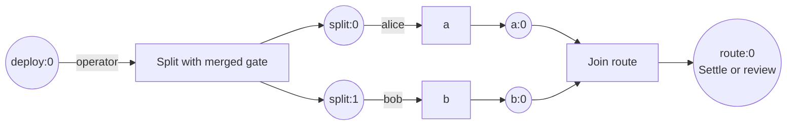

# 4thGraph documentation

[简体中文](README.zh-CN.md) · [4thGraph](../README.md) · [Architecture](architecture.md) · [Forth baseline](language/README.md)

4thGraph puts **Forth rules, UTXO transaction plans, and verification policies** in one build workflow. You describe how state moves, who must authorize each step, and which steps can be submitted independently. The toolchain produces locks and transaction plans, then measures the results with replayable transactions.

[Why Forth](#why-forth) · [CPN transaction plans](#cpn) · [Verification and recursive proofs](#verification) · [Automate builds and measurements](#build-and-measure) · [Documentation index](#documentation-index)

<a name="why-forth"></a>

## Why Forth

Forth and Bitcoin Script both pass values on a stack. Forth gives those operations names so that a state transition or signature check can become a reusable word. 4thGraph uses Forth 2012 Core as its semantic baseline and compiles a subset amenable to static checking. The stack effect `advance ( u32 -- u32 )` makes the 32-bit input and output explicit. The compiler checks calls, branch joins, and numeric ranges, then uses those facts to remove provably redundant operations and reduce stack shuffling. It can also compile supported relation words into circuit constraints. [Language specification](language/specification.md) · [Counter source](../projects/proof-counter/counter.fth)

<a name="cpn"></a>

## How a CPN describes transactions

A CPN is a Colored Petri Net. 4thGraph builds a stage dependency graph from Forth declarations and lowers the chosen transaction layout into a CPN plan. The plan refers to outputs by `step:vout`. Once the parent transaction bytes are known, the runtime binds the actual `txid:vout` and prepares signing requests. [Transaction graph specification](language/specification.md#交易图)

| CPN concept | What it represents in 4thGraph |
| --- | --- |
| Place | A logical output slot. Work outputs, results, state, and receipts have distinct types. |
| Token | An actual spendable output at a place, with its outpoint, amount, locking script, and deployment root. |
| Transition | A transaction that consumes specified inputs and creates ordered outputs. The plan records the stages, signing roles, witnesses, and transaction field constraints. |
| Marking | The live outputs supplied by the runtime. The CPN checks combine them with available witnesses, signing roles, and block height to list ready steps or missing prerequisites. |

These are the two spendable branches of a split in the gated parallel example. Alice and Bob each spend one work output. The join checks that both results come from the same split and consumes them in the order `a:0`, `b:0`.



If the contract declares a timeout refund, the ordinary path and the refund can compete to spend the same output. The node checks the actual UTXO set and executes Script to decide whether the spend succeeds. Use `--cpn` to draw the chosen plan in Mermaid or `--cpn-plan` to export its canonical encoding. The build records its digest as `plan_sha256`. One plan describes a finite execution. A long-running contract passes state to the next spend in a successor UTXO. [Executable transaction graph and examples](toolchain.md#可执行交易图) · [Timeout recovery](toolchain.md#超时退出)

<a name="verification"></a>

## Verification compilation and recursive zero-knowledge proofs

**Transaction compilation determines where each output is spent. Verification compilation determines what evidence makes that spend valid.** For a supported `relation:`, the verifier planner can compare direct Script, transparent R1CS with a public assignment, and Groth16 with a matching circuit and setup. Each path must enforce the state transition and successor outputs. Proof-based paths also bind public signals to the actual spend so a valid proof cannot be substituted for another set of inputs or outputs. Keeping data private also requires defining which values stay in the witness and which commitments or results must be public. [Verification paths and build requirements](language/stdlib.md#verification-paths) · [Groth16 verifier](groth16-bls12-381.md)

Recursive proofs address applications that must **authenticate the origin of each new state as its history grows**. The existing serial example carries prior transaction bytes and traces them back to the deployment root. Its witness grows with the number of stages. A recursive construction would start from a trusted initial state or issuance anchor. The next proof would verify the preceding proof and the current transition, with the authenticated previous state bound to the input being spent and the next state constrained. A verifier could check the accumulated history relation with one proof. Measuring proving cost and on-chain verification requires the actual circuit. Node-validated chain state still determines whether the transaction is included and whether the output remains spendable. [Current serial verification](language/specification.md#交易声明) · [Proof counter](../projects/proof-counter/README.md)

The toolchain supports proof builds for bounded state relations today. **Recursive proofs and joint selection across stages remain research.** The goal is to search transaction boundaries and per-stage verification backends together, satisfy authorization, data availability, and privacy requirements, then compare proof size, proving time, total transaction bytes, and confirmation dependencies. [Roadmap](toolchain.md#路线图)

<a name="build-and-measure"></a>

## Generate scaffolding, replay, and measure

The same contract rules can generate candidates, test transactions, and reports, so a developer can compare two builds under the same conditions.

1. **Build candidates.** Apply `safe` or `stack` optimizations to Forth words. At the transaction layer, enumerate supported boundaries and witness layouts, including a fused spend, a split layout, and a separate gate transaction where supported. Exclude candidates that violate independent submission or signer availability and record the reasons.
2. **Rank by the chosen objective.** `--search --explain` shows the candidates and how the compiler chose one. `path-bytes` ranks by estimated total path size. `peak-validation` prioritizes the maximum signature checks in any one transaction, then compares input script bytes.
3. **Generate and replay test transactions.** The replay runner uses public test keys to fund, deploy, exercise, and settle the contracts. The gated parallel fixture exercises settlement and review for every eligible candidate and checks rejection cases such as a result from another split or a wrong output.
4. **Generate a report and rerun.** The report ties each transaction to its build digest and records total bytes, largest transaction, dependency depth, development-evaluator stack payload, and timing and verdicts from both engines. Rerun the same fixture after changing a rule, budget, or availability assumption to see whether saving bytes adds transactions or verification cost. [Candidate search](toolchain.md#有界候选搜索) · [Decision reports](toolchain.md#编译决策报告)

After installing the regtest dependencies, run these commands from the repository root to collect the candidate builds, signed transactions, mining records, and Markdown and JSON reports. [Regtest dependencies](toolchain.md#复放与编译)

```sh
bash tools/setup-workspaces.sh
out=projects/workflow-examples/workspace/build
bash tools/verify_node.sh --profile default -- \
  python -m fourthgraph.replay.workflow --search --topology gated-parallel \
  --target both --optimize stack --samples 7 --output "$out/search-replay.json"
PYTHONPATH=src:. python -m fourthgraph.reporting "$out/search-replay.json" \
  --output-dir "$out/decision"
```

In this regtest replay, all five candidates passed both settlement and review, for ten passing paths. The table compares the winner for each objective. Settlement bytes cover deployment and every transaction on the path. Signature encoding can change the byte count on another run.

| Objective | Selected layout | Measured settlement bytes | Maximum signature checks per transaction |
| --- | --- | ---: | ---: |
| `path-bytes` | Fused | 1,558 B | 4 |
| `peak-validation` | Split, merged gate, `shared` witness | 11,486 B | 2 |

For another run, pass `--objective peak-validation` to change the ranking or `--available-authorizers operator` to model a first step where only the operator can sign. Save a separate replay and report for each run so you can compare exclusions, successful paths, and rejections. The next step for scaffolding is to let more projects generate the same artifacts from their stage declarations and test fixtures. [Gated example source](../projects/workflow-examples/gated.fth)

<a name="agent-tuning-loop"></a>

## The Agent development and tuning loop

1. **Write and freeze the high-level Forth.** Specify the required outputs, state transition, authorization, and failure cases. Keep the baseline Script and pin the compiler, dependencies, target, and fixtures.
2. **List the available paths side by side.** Compare Forth implementations with the compiler plan fixed, or compare compiler pass sets and bounded orders with the Forth source fixed. For transaction-level changes, compare eligible transaction cuts and witness layouts under the same contract and required coverage. Use `4thgraph experiment capabilities` for the formula fixture catalog, `--search --explain` for transaction workflow candidates.
3. **Let the Agent pick a bounded batch.** Submit registered choices and a budget. The formula runner compiles in parallel up to the requested worker limit and evaluates the outputs against fixed vectors. Keep each variant in its own artifact or report.
4. **Read the evaluation and choose again.** Check compile and test verdicts before ranking. Formula reports contain Script bytes, stack peaks, timings, and candidate hashes. Full-path comparisons require independently validating each spend against its actual parent and measuring serialized transaction bytes. Keep unavailable measurements marked as such.
5. **Record the chosen plan and replay.** Retain source and dependency identity, target, selected plan, linked Script and fragment hashes, and the validation receipt. An Agent can use the machine report to choose the next batch. Another run can reproduce the recorded result without an Agent.

Try a baseline and two formula plans. Both rounds use the same Bézier fixture and fixed evaluator. The `next` command produces a sample follow-up request that an Agent can inspect and select from.

Axis A uses the same implementation without passes or rules as its baseline. Axis B uses the fixture's reference implementation under the same pass set and rule order. Follow-ups can carry a verified matching baseline forward. When none is available, the baseline delta is `null`. Candidates derived from different parents have separate IDs and can share an artifact hash.

`time_ms` sets a deadline for starting batches after request preparation. An admitted batch finishes compiling and running its vectors. The report records `time_budget` when the deadline is reached, and replay runs the exact admitted candidates. With `"trace": true`, replay also checks the saved formula snapshots.

```sh
export PYTHONPATH=src:.
mkdir -p workspace/tuning
python3 -m fourthgraph.workflow.protocol experiment capabilities
printf '%s\n' '{"fixture":"bezier","workers":2,"plans":[{},{"passes":["stack"]},{"passes":["rewrite","share","stack"]}]}' |
  python3 -m fourthgraph.workflow.protocol experiment run - > workspace/tuning/first.json
python3 -m fourthgraph.workflow.protocol experiment next workspace/tuning/first.json > workspace/tuning/next.json
python3 -m fourthgraph.workflow.protocol experiment run workspace/tuning/next.json \
  --parent workspace/tuning/first.json > workspace/tuning/second.json
python3 -m fourthgraph.workflow.protocol experiment replay workspace/tuning/second.json \
  --parent workspace/tuning/first.json
```

For the registered `square` or `bezier` spend fixture, set `"evaluation":"spend"` and use the same commands in an environment with [pinned chain-gang](../tools/requirements-chronicle.txt). The runner first checks the formula vectors, then links the candidate into synthetic funding outputs and checks complete spends against those parents offline. Each vector expects one acceptance and one rejection. Formula evaluation remains the default.

```sh
printf '%s\n' '{"fixture":"square","evaluation":"spend","workers":2,"plans":[{},{"passes":["stack"]}]}' |
  python3 -m fourthgraph.workflow.protocol experiment run - > workspace/tuning/spend.json
python3 -m fourthgraph.workflow.protocol experiment next workspace/tuning/spend.json > workspace/tuning/spend-next.json
python3 -m fourthgraph.workflow.protocol experiment run workspace/tuning/spend-next.json \
  --parent workspace/tuning/spend.json > workspace/tuning/spend-second.json
python3 -m fourthgraph.workflow.protocol experiment replay workspace/tuning/spend-second.json \
  --parent workspace/tuning/spend.json
```

Spend evaluation ranks passing candidates by the maximum serialized funding-plus-spend bytes across the vectors. The path total adds both transactions from the same vector. The individual maxima for lock, witness, funding, and spend can come from different vectors. The report records the engine pin, Script hashes, and transaction IDs. The reported stack peaks describe the formula evaluation. Complete-spend stack peaks are unmeasured for these fixtures. [Workflow replay](toolchain.md#复放与编译) · [Agent skill](../skills/4thgraph/SKILL.md)

To run the two Bézier batches above through the same spend check, add `"evaluation":"spend"` to the first request. All 625 vectors run with the same Forth and transaction context across candidates. The linked lock checks both position and tangent. The rejection set includes cases where only the position changes and cases where only the tangent changes. The report carries those spend receipts into `next` and `replay`.

Add `"trace":true` when comparing terminal schedules. The report links the final formula snapshot to graph slots through `formula_slots`. Under `trace.target_stack_plan`, `steps` lists the selected execution order, actual operand order, abstract stack slots before and after each step, and exact spans in the emitted Script. `operation_offset` marks where the operation starts after stack rearrangement. `finish` records return placement and cleanup. The schedule records whether source order or a beam-search order won. Follow-up requests preserve tracing, and replay checks the trace, Script, test verdicts, deterministic costs, and ranking. Trace collection adds work to observed compile times.

To compare the shortlisted plans, run axis B once per plan with tracing off and a single worker. Each run holds the plan fixed while comparing `bezier` and `bezier-linear`. From the repository root, with `PYTHONPATH` set as above and the pinned engine installed:

```sh
for plan in stack search; do
  passes='["stack"]'
  if [ "$plan" = search ]; then passes='["rewrite","share","stack","search"]'; fi
  printf '{"fixture":"bezier","axis":"B","evaluation":"spend","trace":false,"plans":[{"implementation":"bezier","passes":%s},{"implementation":"bezier-linear","passes":%s}]}\n' "$passes" "$passes" |
    python3 -m fourthgraph.workflow.protocol experiment run - > "workspace/tuning/bezier-$plan.json"
  python3 -m fourthgraph.workflow.protocol experiment replay "workspace/tuning/bezier-$plan.json" > "workspace/tuning/bezier-$plan-replay.json"
done
```

| Implementation | Plan | Full path | Formula Script | Formula main / alt peak items |
| --- | --- | ---: | ---: | ---: |
| `bezier-linear` | `rewrite`, `share`, `stack`, `search` | 176 B | 34 B | 8 / 1 |
| `bezier-linear` | `stack` | 179 B | 37 B | 8 / 1 |
| `bezier` | `rewrite`, `share`, `stack`, `search` | 188 B | 46 B | 10 / 1 |
| `bezier` | `stack` | 189 B | 47 B | 9 / 1 |

Each combination has 625 accepted and 625 rejected spends. The shortest path uses `bezier-linear` with all four passes. When path bytes tie, ranking prefers the plan with fewer passes and ordered rules. Read `metrics.compile_ns` from the trace-off runs or replays for observed compile time.

### Call-site selection

The standard library maintains curve kernels and their input ranges, coordinate representations, and edge behavior. The compiler maintains call-site matching and binding plans and accounts for adaptation, guards, and linking. Compare bindings with the same Forth caller and fixed kernels. A range-specialized kernel uses the same process and requires evidence of its bounds at the call site.

```sh
printf '%s\n' '{"fixture":"point-add","evaluation":"spend","enumerate":"bindings","workers":2}' |
  python3 -m fourthgraph.workflow.protocol experiment run - > workspace/tuning/point-add.json
python3 -m fourthgraph.workflow.protocol experiment replay workspace/tuning/point-add.json
```

Call site 0 uses a constant verified at build time and admits complete projective addition or affine-right addition. Call site 1 receives a valid projective point on the runtime stack. It admits complete projective addition or the registered `secp256k1-add-affine-guarded` binding. The latter selects the affine kernel on an exact byte match for canonical ScriptNum `1` in the right operand's `Z`, and otherwise uses complete projective addition. The caller's valid-point contract still applies. Linked size includes the guard and both branches. The fixture covers `Z` values of 0, 1, 2, and 11 and checks the computation against an independent group oracle and pinned chain-gang. [Fixture source](../src/fourthgraph/benchmark/fixtures/point-add.fth)

Use `"plans":[{"bindings":[{"site":1,"kernel":"secp256k1-add-affine-guarded"}]}]` to test one explicit binding. Read `compile.lowering.call_sites` for evidence, exclusions, the selected implementation, and the costs in `guard_bytes`, `kernel_bytes`, and `bytes` (the linked call site). `adapter_bytes` includes the guard when present. A guarded binding also records both kernel digests and their offsets relative to the call site. The compiler rejects wrong curves, duplicate bindings, unknown call sites, and forced kernels whose preconditions are unproved.

| Constant site | Runtime site | Runtime guard / kernels / linked | Full path |
| --- | --- | ---: | ---: |
| Affine | General | 0 / 97 / 97 B | 777 B |
| General | General | 0 / 97 / 97 B | 789 B |
| General | Guarded | 7 / 183 / 190 B | 882 B |

All three plans pass the same 13 accepted and 13 rejected spends. The byte-ranked winner uses the constant affine binding and the runtime general binding. The guarded runtime binding remains available for replay.

<a name="documentation-index"></a>

## Documentation index

| What you want to do | Where to go |
| --- | --- |
| Build a first contract | [Start with an Agent](../README.md#start-with-agent) · [Install the CLI and skill](install.md) · [Runnable projects](../projects/README.md) |
| Compare and replay optimization candidates | [Agent development and tuning loop](#agent-tuning-loop) |
| Write Forth for BSV | [SDL specification, syntax, and standard library](language/README.md) |
| Compile and replay a transaction workflow | [Toolchain guide](toolchain.md) · [Regtest infrastructure](infrastructure.md) · [Chronicle regression](chronicle-regression.md) |
| Generate or verify a proof | [Proof counter](../projects/proof-counter/README.md) · [BLS12-381 Groth16](groth16-bls12-381.md) |
| Connect a wallet and signer | [Wallet SDK](../sdk/README.md) |
| Review or reproduce measurements | [Showcase](../showcase/README.md) · [Transaction benchmarks](benchmark.md) |
| Find source, fixtures, and workspaces | [Repository layout](repository-layout.md) |
| Write or update project documentation | [Documentation templates and maintenance](maintaining-docs.md) |
