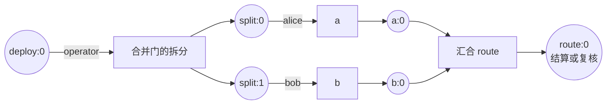

# 4thGraph 文档

[English](README.md) · [4thGraph](../README.zh-CN.md) · [架构](architecture.zh-CN.md) · [Forth 基线](language/README.md)

4thGraph 把 **Forth 规则、UTXO 交易计划和验证策略**放在一条构建流程里。开发者声明状态怎样推进、谁必须授权、哪些阶段可以独立提交。工具链据此生成锁与交易计划，再用可复放的交易数据衡量构建结果。

[为什么选 Forth](#why-forth) · [CPN 交易计划](#cpn) · [验证编译与递归证明](#verification) · [自动构建和测量](#build-and-measure) · [文档索引](#documentation-index)

<a name="why-forth"></a>

## 为什么选 Forth

Forth 和 Bitcoin Script 都通过栈传递值。Forth 提供可命名、可组合的词，开发者可以把状态转换和验签规则写成可复用的定义。4thGraph 以 Forth 2012 Core 为语义基线，编译其中适合静态检查的子集。`advance ( u32 -- u32 )` 明确表示输入和输出都是 32 位无符号数。编译器可以检查词的调用、分支汇合和数值范围，再将这些信息用于删去可证明冗余的操作和优化栈搬运。受支持的关系词还可编译为电路约束。[语言规范](language/specification.md) · [计数器源码](../projects/proof-counter/counter.fth)

<a name="cpn"></a>

## CPN 怎样描述交易

CPN 是有色 Petri 网（Colored Petri Net）。4thGraph 先从 Forth 声明生成阶段依赖图，再把选定的交易布局编译成 CPN 计划。计划用 `步骤:vout` 引用已有输出。父交易字节确定后，运行器再绑定真实的 `txid:vout` 并准备签名请求。[交易图规范](language/specification.md#交易图)

| CPN 概念 | 在 4thGraph 里对应什么 |
| --- | --- |
| 库所（place） | 一个逻辑输出槽。工作输出、结果、状态和回执有各自的类型。 |
| 令牌（token） | 占用槽位的实际可花费输出。它带有 outpoint、金额、锁脚本和部署根等上下文。 |
| 变迁（transition） | 一笔消费指定输入并创建有序输出的交易。计划记录对应阶段、签名角色、所需见证和交易字段约束。 |
| 标记（marking） | 由运行时提供的活跃输出集合。CPN 检查接口结合现有见证、可用签名角色和区块高度，列出就绪步骤或缺失的条件。 |

下面取带门并行示例里同一笔拆分的两条可花费分支。Alice 和 Bob 各自花费一个工作输出。汇合检查两个结果来自同一次拆分，并按 `a:0`、`b:0` 的顺序消费。



声明超时退款后，正常路径和退款可以竞争同一个输出。节点依据真实 UTXO 集和 Script 决定实际花费能否成立。`--cpn` 从选定计划生成 Mermaid，`--cpn-plan` 导出同一计划的规范编码，构建产物中的 `plan_sha256` 标识这份计划。单次计划描述有限的阶段，持续运行的合约通过后继 UTXO 把状态交给下一次花费。[可执行交易图与示例](toolchain.md#可执行交易图) · [超时退出](toolchain.md#超时退出)

<a name="verification"></a>

## 验证编译与递归零知识证明

**交易编译决定在哪笔交易花费哪个输出。验证编译决定用什么证据接受这次花费。** 对于受支持的 `relation:`，验证规划器可以比较直接 Script、公开完整赋值的透明 R1CS，以及使用匹配电路和设置文件的 Groth16。各路径都要约束状态转换和后继输出。证明路径还要把公开信号绑定到实际花费，避免一份正确证明被用于另一组输入或输出。要保护私有数据，还需明确哪些值只进入见证，哪些状态承诺或结果必须公开。[验证路径与构建条件](language/stdlib.zh-CN.md#验证路径) · [Groth16 验证器](groth16-bls12-381.md)

递归证明面向**每一步都要验证状态来源、而历史又会不断增长**的应用。已有串行例子让后续花费携带前序交易字节并回查部署根，阶段越多，见证越长。递归方案从可信的初始状态或发行锚开始，由新证明验证前序证明和本次转换，再把前序证明认证的状态绑定到当前输入，并约束下一状态。这让验证者有机会用一份证明检查累积的历史关系，证明成本和链上验证开销仍需针对实际电路测量。交易是否入块、输出是否仍可花费，仍以节点验证的链状态为准。[当前串行验证](language/specification.md#交易声明) · [证明计数器](../projects/proof-counter/README.zh-CN.md)

当前工具链已经支持有界状态关系的证明构建。**递归证明和跨阶段联合选择仍在研究。** 项目希望把交易切分和每阶段的验证后端一起搜索，在授权、数据可用性和隐私要求成立时，再比较证明体积、出证时间、整路交易成本和确认依赖。[路线图](toolchain.md#路线图)

<a name="build-and-measure"></a>

## 自动生成脚手架，复放，再测量

从同一份合约规则自动生成候选、测试交易和报告，开发者就能用同一组条件比较两次构建。

1. **构建候选。** 字节码层用 `safe` 或 `stack` 优化词。交易层在受支持的拓扑上枚举可选边界和见证布局，例如融合、拆分以及门阶段是否独立。违反独立提交或签名可用性等约束的候选先排除，理由写入报告。
2. **按目标排序。** `--search --explain` 给出候选和选择依据。`path-bytes` 按估算的整路字节数排序，`peak-validation` 优先降低单笔最大签名检查数，再比较输入脚本字节数。
3. **生成并复放测试交易。** 复放器使用公开测试密钥创建入金、部署、工作和结算交易。带门的并行夹具会遍历每个合格候选的结算与复核路径，同时检查来自另一次拆分的结果、错误后继输出等拒绝用例。
4. **生成报告并复跑。** 报告按构建摘要关联交易，记录整路和最大单笔字节数、依赖深度、本地求值器测得的栈载荷，以及双引擎的验证结果和耗时。调整规则、预算或可用性假设后，用同一夹具再跑一轮，检查字节节省是否带来额外交易或验证成本。[候选搜索](toolchain.md#有界候选搜索) · [编译决策报告](toolchain.md#编译决策报告)

安装 regtest 依赖后，从仓库根目录运行下面这组命令，即可得到候选构建、签名交易、入块记录，以及 Markdown 和 JSON 报告。[Regtest 依赖](toolchain.md#复放与编译)

```sh
bash tools/setup-workspaces.sh
out=projects/workflow-examples/workspace/build
bash tools/verify_node.sh --profile default -- \
  python -m fourthgraph.replay.workflow --search --topology gated-parallel \
  --target both --optimize stack --samples 7 --output "$out/search-replay.json"
PYTHONPATH=src:. python -m fourthgraph.reporting "$out/search-replay.json" \
  --output-dir "$out/decision"
```

本次 regtest 复放中，5 个候选各跑了结算和复核，共 10 条通过。下面比较两个目标各自选中的布局。实测字节包含部署和结算路径上的全部交易，签名编码会影响复跑的字节数。

| 排序目标 | 选中布局 | 结算路径实测 | 最大单笔签名检查数 |
| --- | --- | ---: | ---: |
| `path-bytes` | 融合 | 1,558 B | 4 |
| `peak-validation` | 拆分，将门与拆分合并，使用 `shared` 见证 | 11,486 B | 2 |

下一轮可以用 `--objective peak-validation` 换排序目标，或者用 `--available-authorizers operator` 模拟首步只有 Operator 能签名。为每轮保留不同的复放文件和报告目录，再对照排除理由、正向轨迹和拒绝用例。后续脚手架的重点是让更多项目从自己的阶段声明和测试夹具生成这一套产物。[带门示例源码](../projects/workflow-examples/gated.fth)

<a name="agent-tuning-loop"></a>

## Agent 开发与调优循环

1. **从高层 Forth 开始。** 写清输出、状态转换、授权和必须拒绝的情况。保存基线 Script，固定编译器、依赖、目标与验收夹具。
2. **并列列出可复跑的选择。** 源码路径固定编译计划，比较不同 Forth 实现。编译路径固定源码，比较可用 pass 集合和有限次序。交易路径固定业务与签名覆盖，比较合法的交易切割和见证布局。用 `4thgraph experiment capabilities` 查公式夹具和规则，用 `--search --explain` 看交易计划候选。
3. **Agent 选择本轮候选与预算。** 将选择提交给编译器。公式执行器按工作线程预算并行编译，再用固定向量验证产物。每个变体保留独立产物或报告。
4. **用固定评估结果决定下一轮。** 先查编译及测试判定，再比较 Script 字节、栈峰值、编译耗时与候选摘要。整路比较要从真实前序组装花费，独立验收后再量序列化交易字节。缺测的指标在报告中标出。
5. **冻结选定方案并复跑。** 保存源码和依赖身份、目标、实际计划、链接后 Script 和片段摘要、验证回执。Agent 可以读机器报告继续选下一批，留下的请求与产物足以独立重放。

以下用同一个 Bézier 夹具和固定评估器比较基线与两个计划，再跑一轮。`next` 输出一个供 Agent 检查和选用的后续请求。

轴 A 的基线是同一实现下未应用 pass 和规则的版本。轴 B 的基线是按相同 pass 集合与规则顺序构建的夹具参考实现。续跑可以沿用已验证且匹配的基线。缺少匹配基线时，基线差值为 `null`。从不同父候选派生的候选有各自的 ID，可以共用产物摘要。

`time_ms` 设置请求准备完毕后启动新批次的截止时间。已启动的批次会完成编译与向量验证。达到截止时间时报告记录 `time_budget`，重放会运行当时已启动的候选。设置 `"trace": true` 时，重放还会校验保存的公式快照。

```sh
export PYTHONPATH=src:.
mkdir -p workspace/tuning
python3 -m fourthgraph.workflow.protocol experiment capabilities
printf '%s\n' '{"fixture":"bezier","workers":2,"plans":[{},{"passes":["stack"]},{"passes":["rewrite","share","stack"]}]}' |
  python3 -m fourthgraph.workflow.protocol experiment run - > workspace/tuning/first.json
python3 -m fourthgraph.workflow.protocol experiment next workspace/tuning/first.json > workspace/tuning/next.json
python3 -m fourthgraph.workflow.protocol experiment run workspace/tuning/next.json \
  --parent workspace/tuning/first.json > workspace/tuning/second.json
python3 -m fourthgraph.workflow.protocol experiment replay workspace/tuning/second.json \
  --parent workspace/tuning/first.json
```

对已登记的 `square` 或 `bezier` 花费夹具，在安装了[固定版 chain-gang](../tools/requirements-chronicle.txt) 的环境中用相同命令加上 `"evaluation":"spend"`。执行器先检查公式向量，再把候选链接进合成资金输出，离线对照这些实际父交易验证完整花费。每个向量预期一次通过、一次拒绝。默认仍运行公式评估。

```sh
printf '%s\n' '{"fixture":"square","evaluation":"spend","workers":2,"plans":[{},{"passes":["stack"]}]}' |
  python3 -m fourthgraph.workflow.protocol experiment run - > workspace/tuning/spend.json
python3 -m fourthgraph.workflow.protocol experiment next workspace/tuning/spend.json > workspace/tuning/spend-next.json
python3 -m fourthgraph.workflow.protocol experiment run workspace/tuning/spend-next.json \
  --parent workspace/tuning/spend.json > workspace/tuning/spend-second.json
python3 -m fourthgraph.workflow.protocol experiment replay workspace/tuning/spend-second.json \
  --parent workspace/tuning/spend.json
```

花费评估按各向量中「资金交易加花费交易」的最大序列化字节数，对通过验收的候选排名。路径总字节使用同一向量的两笔交易。锁、见证、资金交易和花费交易各自的峰值可能来自不同向量。报告也记录引擎提交、Script 摘要和交易 ID。所报栈峰值来自公式评估，完整花费的栈峰值尚未测量。[工作流复放](toolchain.md#复放与编译) · [Agent skill](../skills/4thgraph/SKILL.md)

要把上面的两轮 Bézier 实验接到完整花费上，在第一轮请求中加 `"evaluation":"spend"`。各候选固定同一份 Forth 和交易上下文，跑同一组 625 个向量。链接后的锁同时检查位置和切向量。拒绝用例分别覆盖只改变位置和只改变切向量的情况。花费回执随报告进入 `next` 和 `replay`。

比较终端栈调度时加 `"trace":true`。报告用 `formula_slots` 把最后一份公式快照的节点关联到图槽位。在 `trace.target_stack_plan` 中，`steps` 记录实际选中的执行顺序、操作数排布、每步前后的抽象栈槽和 Script 字节范围。经过栈调整后，`operation_offset` 指向实际操作的起始字节。最后的 `finish` 记录返回值排布和清理。报告标明选中源码顺序还是束搜索顺序。后续请求沿用追踪开关，重放会核对追踪、Script 和测试判定。开启追踪会增加所测的编译耗时。

四格对照按两套入围计划分别运行 B 轴，关闭追踪并使用单个编译 worker。每轮固定计划，比较 `bezier` 和 `bezier-linear`。在仓库根目录执行，沿用上面的 `PYTHONPATH` 和固定版本的评估引擎。

```sh
for plan in stack search; do
  passes='["stack"]'
  if [ "$plan" = search ]; then passes='["rewrite","share","stack","search"]'; fi
  printf '{"fixture":"bezier","axis":"B","evaluation":"spend","trace":false,"plans":[{"implementation":"bezier","passes":%s},{"implementation":"bezier-linear","passes":%s}]}\n' "$passes" "$passes" |
    python3 -m fourthgraph.workflow.protocol experiment run - > "workspace/tuning/bezier-$plan.json"
  python3 -m fourthgraph.workflow.protocol experiment replay "workspace/tuning/bezier-$plan.json" > "workspace/tuning/bezier-$plan-replay.json"
done
```

| 实现 | 计划 | 完整路径 | 公式 Script | 公式主栈／备用栈峰值项数 |
| --- | --- | ---: | ---: | ---: |
| `bezier-linear` | `rewrite`、`share`、`stack`、`search` | 176 B | 34 B | 8／1 |
| `bezier-linear` | `stack` | 179 B | 37 B | 8／1 |
| `bezier` | `rewrite`、`share`、`stack`、`search` | 188 B | 46 B | 10／1 |
| `bezier` | `stack` | 189 B | 47 B | 9／1 |

每种组合均有 625 个花费通过和 625 个花费拒绝。最短路径用 `bezier-linear` 的四 pass 计划。路径字节相同时，优先选择 pass 和有序规则合计较少的计划。实际编译耗时可从关闭追踪的运行或重放报告中读取 `metrics.compile_ns`。

### 调用点选型

标准库维护曲线内核及其输入范围、坐标表示和边界行为。编译器维护调用点的匹配和绑定方案，并计入转换、守卫与链接成本。用同一份 Forth 调用方和固定内核比较绑定，范围专用的内核也沿用相同的流程，调用点须先有对应的范围证据。

```sh
printf '%s\n' '{"fixture":"point-add","evaluation":"spend","enumerate":"bindings","workers":2}' |
  python3 -m fourthgraph.workflow.protocol experiment run - > workspace/tuning/point-add.json
python3 -m fourthgraph.workflow.protocol experiment replay workspace/tuning/point-add.json
```

点加夹具在调用点 0 使用构建期验证过的常量，支持完整射影点加和仿射右操作数两条候选路径。调用点 1 从运行时栈接收合法射影点，保留完整射影实现。可用 `"plans":[{"bindings":[{"site":0,"kernel":"secp256k1-add-affine"}]}]` 重放单个显式绑定。报告在 `compile.lowering.call_sites` 给出证据、排除原因、选中内核、转换和链接字节。错曲线、重复绑定或强制使用前提不足的内核均在编译期拒绝。夹具用独立的群运算结果和固定版 chain-gang 验收计算。[夹具源码](../src/fourthgraph/benchmark/fixtures/point-add.fth)

<a name="documentation-index"></a>

## 文档索引

| 目标 | 文档 |
| --- | --- |
| 构建第一个合约 | [用 Agent 开始](../README.zh-CN.md#start-with-agent) · [安装 CLI 和 skill](install.md) · [可运行项目](../projects/README.zh-CN.md) |
| 选择、验证和复跑优化候选 | [Agent 开发与调优循环](#agent-tuning-loop) |
| 用 Forth 写 BSV 合约 | [SDL 规范、语法书和标准库](language/README.md) |
| 编译并复放交易工作流 | [工具链手册](toolchain.md) · [Regtest 环境](infrastructure.md) · [Chronicle 回归测试](chronicle-regression.md) |
| 生成或验证证明 | [证明计数器](../projects/proof-counter/README.zh-CN.md) · [BLS12-381 Groth16](groth16-bls12-381.md) |
| 接入钱包和签名器 | [钱包 SDK](../sdk/README.zh-CN.md) |
| 查阅或复现实测结果 | [项目成果](../showcase/README.md) · [完整交易基准](benchmark.zh-CN.md) |
| 查找源码、夹具和工作区 | [仓库目录](repository-layout.md) |
| 编写和维护项目文档 | [文档模板和维护约定](maintaining-docs.zh-CN.md) |
