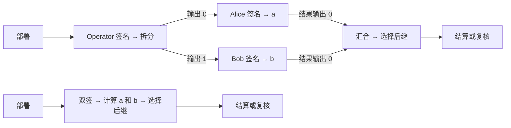

# 4thGraph

A Forth compiler for BSV Script and multi-transaction workflows.

当前构建版本为 **v0.2.7**。编译与复放产物可写入 `workspace/build/`。运行 `bash tools/setup-workspaces.sh` 初始化。

用 `REQUIRE stdlib/<file>.fth` 加载 4thGraph 标准库。计数器、原生支付、P-256 内核、BIP340 和 BLS12-381 Groth16 已提供库入口。同一份 Forth 源码可以组合库词，也可以通过 `relation:` 让编译器在符合条件的 Script 与证明路径间选择。 [语法书](language/syntax.md) · [标准库与验证路径](language/stdlib.md)

同一份 Forth 源码可以生成融合版和拆分版。示例计算 `a = 2x`、`b = y + 1`，两支结果和汇合的和都按 `u32` 表示。回绕后的和小于 20 时走复核，其余走结算。两种后继各锁给一个配置的公钥。编译器以 Forth 2012 Core 为语义基线，`+` 使用 64 位 cell，`u32+` 固定按 32 位回绕。 [示例源码](../projects/workflow-examples/example.fth) · [语言与 BSV 扩展规范](language/specification.md)

可独立安装 `4thgraph` CLI 和 Codex 的 `$4thgraph` skill。Skill 包含 Forth 编写、编译优化和复放证据检查的工作流。 [安装说明](install.md)

## 复放与编译

从仓库根目录运行。Node 启动器创建临时、无对等节点的 regtest，下载并校验 BSV Node 1.2.3。

```sh
python -m venv workspace/venv
. workspace/venv/bin/activate
python -m pip install ecdsa -r tools/requirements-chronicle.txt
bash tools/setup-workspaces.sh
PYTHONPATH=src:. python -m unittest discover -v -s tests
PYTHONPATH=src:. bash tools/verify_node.sh --profile default -- \
  python -m fourthgraph.replay.workflow --output workspace/replay.json --samples 21
```

编译和复放都用 `--target` 选目标。三个目标默认使用 BIP143 ALL（`0x41`）。命令行与新报告使用 `bip143` 和 `otda`。旧拼写 `forkid-v1`、`forkid` 和 `chronicle` 仍分别可用作 `bip143-v1`、`bip143` 和 `otda` 的输入别名。

| 目标 | 合约锁接受的版本 | 实例化默认版本 |
| --- | --- | --- |
| `bip143-v1` | v1 | v1 |
| `chronicle-v2`（默认） | v2 | v2 |
| `both` | v1、v2 | v2 |

用 `both` 部署后，可为各步独立选择版本，例如 `Contracts.prepare("a", completed, {"x": 10}, version=1)`。同一工作流可以用 v1 和 v2 的结果共同汇合。各锁核对当前交易的版本，汇合还核对两笔结果父交易各自的版本。若已有部署仅接受单一版本，扩大版本集合需要重新部署。版本 1 和双版本模式依赖 BSV Genesis 的 Script 运算和大栈元素能力。

把 regtest 激活高度设到样本区块之后，可复放 Chronicle 激活前的路径：

```sh
REGTEST_CHRONICLE_HEIGHT=1000 PYTHONPATH=src:. bash tools/verify_node.sh --profile default -- \
  python -m fourthgraph.replay.workflow --target bip143-v1 --output workspace/replay-v1.json --samples 21

PYTHONPATH=src:. bash tools/verify_node.sh --profile default -- \
  python -m fourthgraph.replay.workflow --target both --output workspace/replay-both.json --samples 21
```

复放 JSON 保存源码、两套脚本和符号模板、每笔交易的原始字节与真实 outpoint、每个输入的 BSV Node 脚本判定、Node 入池及挖块结果，以及 chain-gang 的整笔交易判定。启动时使用钱包矿工奖励建立共享资金夹具。报告从各路径自己的部署交易开始计量。

可用复放报告里的测试公钥离线编译。换用自己的公钥时，`keys.json` 的格式为角色名到压缩 secp256k1 公钥十六进制字符串的映射。编译会验证每个必需角色的公钥确实对应曲线上的点。

```sh
jq '.fixture_public_keys' workspace/replay.json > workspace/fixture-keys.json
PYTHONPATH=src:. python -m fourthgraph.workflow.protocol projects/workflow-examples/example.fth \
  --mode split --target both --keys workspace/fixture-keys.json --task-id "$(jq -r .task_id workspace/replay.json)"
PYTHONPATH=src:. python -m fourthgraph.workflow.protocol --capabilities
```

`--mode auto` 在所有输入和分支授权都可同时取得时选融合。可用 `--available-data x` 或 `--available-authorizers alice` 模拟另一支晚到。往示例末尾加上 `independent-submit: a ;` 后，`auto` 选择拆分，`--mode fused` 报告约束的源文件行号。可显式请求拆分，在两种调度都合法时做同源对照。

### 编译公开状态关系

`relation: advance decide ;` 指定一个 `u32 -- u32` 转换词和一个 `u32 -- route` 路由词。构建器从同一次源码解析取得两个词，将初始状态固定在锁中，核对花费的实际后继付款和状态回执。分文件定义可用 `REQUIRE` 导入。[完整示例](../projects/proof-counter/verify-state.fth)

```sh
app=projects/proof-counter/verify-state.fth
keys=workspace/fixture-keys.json
PYTHONPATH=src:. python -m fourthgraph.workflow.protocol "$app" --keys "$keys" --current 19
PYTHONPATH=src:. python -m fourthgraph.verification.circuit_backend "$app" --output "workspace/relation.circom"
PYTHONPATH=src:. python -m fourthgraph.verification.plan "$app" --keys "$keys" --current 19 --policy require-proof
```

默认构建生成直接验证的 Script 并报告 Circom 编译结果。`require-proof` 启用由同一电路生成的透明 R1CS 证明。`--policy require-groth16 --groth16 ZKEY PHASE2_PTAU` 选择 BLS12-381 Groth16，并核对设置文件与生成的 R1CS。`--max-lock-bytes` 在选择候选前限制锁长，`--max-expanded-ops` 限制词展开。证明后端使用 Node.js、npx 和固定版本的 Circom 与 snarkjs。用 `tools/verify_node.sh --profile raised --` 运行上述 `verification.py` 命令并附加 `--replay`，可重跑实际花费。

只有词定义的电路源文件须用 `circuit_backend.py SOURCE --entries TRANSITION ROUTE --output FILE` 显式指定入口。含阶段声明的工作流由阶段依赖决定入口。

Gforth 也可直接构造交易网络并复用同一份规则源码。[Gforth 工作流](../projects/workflow-examples/gforth/README.md)

## 编译决策报告

`protocol.py --explain` 给出候选交易图、可用性假设、逐词改写和选择理由。`replay.py` 的复放格式 2 将原始源码的融合、拆分和带约束的拆分各跑一次结算和复核。六条路径各带其实际使用的构建摘要。

以下命令从仓库根目录生成首份对照。已有 v0.1.0 归档时，会一起收录为历史基线。

```bash
PYTHONPATH=src:. bash tools/verify_node.sh --profile default -- \
  python -m fourthgraph.replay.workflow --target both --optimize stack --join-witness shared \
  --output "workspace/decision-replay.json"

archives=()
for path in workspace/v0.1.0-*parallel-*.json; do
  if [[ -f "$path" ]]; then
    archives+=(--baseline "$path")
  fi
done
PYTHONPATH=src:. python -m fourthgraph.reporting "workspace/decision-replay.json" \
  --output-dir "workspace/decision" "${archives[@]}"
```

报告器离线生成 `decision-report.json` 和 `decision-report.md`。评估另一拓扑时，为复放加上 `--topology gated-parallel`。复审相关的有资金回归可以在独立的 regtest 实例运行。

```sh
PYTHONPATH=src:. bash tools/verify_node.sh --profile default -- \
  python -m unittest discover -v -s tests -p test_regtest.py
```

## 有界候选搜索

`protocol.py --search --explain` 对同一份源码与可用性假设生成候选和选择。带门拓扑最多有五个候选。融合占一个，拆分将门合并或单独提交的两种边界与 `full`、`shared` 两种汇合见证交叉比较。可用 `--mode split`、`--gate-boundary merged|separate` 或 `--join-witness full|shared` 缩小范围。显式门边界也可用于普通构建，便于复现对应候选的摘要。

`--objective path-bytes` 默认按整路字节排序。`--objective peak-validation` 优先降低单笔最大原生签名检查次数，再比较峰值输入脚本字节。报告同时列出结算和复核在 BSV Node 与 chain-gang 的实测耗时。

```sh
PYTHONPATH=src:. bash tools/verify_node.sh --profile default -- \
  python -m fourthgraph.replay.workflow --search --topology gated-parallel --target both \
  --optimize stack --samples 7 --output "workspace/search-replay.json"
PYTHONPATH=src:. python -m fourthgraph.reporting "workspace/search-replay.json" \
  --output-dir "workspace/search-decision"
```

## 语言与运行器

- `: name ( cell -- cell ) 1+ ;` 按 Forth 语义定义词，栈效果注释供 4thGraph 静态检查。受支持的 Core Extension 词可直接使用。构建会报告无法编译到 Script 的用法及源码位置。
- `work: a x double alice ;` 将输入、计算和签名角色连到工作步骤。 `join: route a b decide ;` 按指定顺序声明汇合依赖。 `split-authority: operator ;` 声明启动拆分的签名角色。当前调度器识别一对并行分支和一个汇合。选择交易边界后，后端再内联、折叠字面量和选择 Script 指令。
- 若把第二支改为 `work: b x inc bob ;`，两支都使用同一个 `x`。融合版只需提供一次。拆分版在创建工作输出时锁定 `x`，Alice 和 Bob 之后可各自提交，其签名请求绑定包含该值的实际前输出。若独立的门也使用 `x`，提供它的时点提前到门交易。共享值以明文进入相应的锁脚本。
- 词库声明执行位置和验证依据。Script 词由链上执行。宿主词通过 `Host` 的注入接口查询 UTXO、请求签名和提交交易，并可从 UTXO 取得脚本和 outpoint。测试签名器使用公开可复现的私钥，仅供 regtest。
- `Contracts.prepare` 把符号引用如 `split:0` 解析为已封装父交易的真实 outpoint，核对前输出、已提供的父交易关系，以及汇合结果的槽位、同次拆分来源和编码。含门条件的步骤会先在宿主检查条件。 `Draft.signing_requests` 给外部签名器提供角色、前输出、待签交易、见证输入及 BIP143 ALL 摘要。 `Draft.seal` 校验草稿绑定并装配签名和当前交易原像。实际可花费性仍由 UTXO 集和链上脚本验证。父 txid 改变时，`invalidated` 沿依赖图列出需重新绑定的交易和需更新的授权。

## Schnorr 基础库

`std/secp256k1` 提供曲线常数、完备射影点加和倍点。`std/bip340` 导出 `bip340-verify`，供付款锁和其他合约复用。两者可通过 Script 构建后端的 `REQUIRE` 加载。库接口和依赖记录在编译器的 `--capabilities` 中。[曲线库](../src/fourthgraph/stdlib/secp256k1.fth) · [验签库](../src/fourthgraph/stdlib/bip340.fth)

```python
from importlib import import_module

ScriptBuilder = import_module("fourthgraph.compiler.script_builder").ScriptBuilder
builder = ScriptBuilder("REQUIRE stdlib/bip340.fth\n")
lock = builder.emit("bip340-verify", b"")
```

验签片段要求主栈从底到顶为消息、公钥 x、公钥 y、64 字节签名、nonce y。坐标用 32 字节无符号大端编码，两个 y 均取偶数。验签成功留下一个真值，失败终止执行。调用者可在备用栈保留自己的数据。

标准库的 `secp256k1-scale-affine-pair` 将两个仿射点映射到 `3b = 1` 的同构曲线。缩放坐标使用 `secp256k1-scaled-add-with-field`、`secp256k1-scaled-add-affine-with-field`、`secp256k1-scaled-double-with-field` 和 `secp256k1-scaled-double-pair-with-field`。构建参数 0 表示域素数在主栈底，1 表示域素数紧邻待运算坐标下方。采用位置 1 时，缩放曲线的两种点加分别为 85 和 78 字节，连续两次倍点为 101 字节。BIP340 验签词用自同态分解公开挑战标量，在 64 个两位窗口中联合累加四个 128 位标量。[曲线运算](../src/fourthgraph/stdlib/secp256k1.fth) · [验签实现](../src/fourthgraph/stdlib/bip340.fth)

独立的 P2PKH-Schnorr 示例把所有者承诺和交易绑定组合进付款锁，并通过统一钱包 SDK 构造和识别输出。[付款示例](../projects/p2pkh-schnorr/README.zh-CN.md) · [统一钱包 SDK](../sdk/README.zh-CN.md)

## 交易与验证

`example.fth` 是并行双分支。`gated.fth` 在分支前有一道授权条件。后者可以完整融合、把条件与拆分合并，或将条件交易独立提交后由拆分绑定其输出。`independent-submit: qualify ;` 强制最后一种计划。两个示例共用汇合验证和版本选择。 [带门的源码](../projects/workflow-examples/gated.fth)

```sh
PYTHONPATH=src:. bash tools/verify_node.sh --profile default -- \
  python -m fourthgraph.replay.workflow --topology gated-parallel --target both \
  --optimize stack --join-witness shared --output workspace/gated.json
```



**融合。** 双方对同一笔交易授权。锁在一次 Script 执行中计算两支、在栈上汇合，并按选择验证后继输出的锁和金额。

**拆分。** 启动锁验证有序的两个工作输出。每支只需自己的数据和签名即可花费对应工作输出。工作锁用真实输入的拆分 txid 构造结果锁，并验证第二个输出发布了正确的结果。结果是五字节 ScriptNum，包含四字节无符号值和零符号字节。结果数据附在零值 `OP_FALSE OP_RETURN` 输出上。

**汇合。** 两个输入的锁都接收完整的两笔结果父交易。各自检查它们花费了同一笔拆分的输出 0 和 1，再将两笔父交易的哈希和结果 vout 0 拼成有序的 outpoint 向量，与真实交易原像的 `hashPrevouts` 核对。两个锁都从已核验的交易字节取结果，并检查有且仅有一个正确后继输出。任务 ID 只标识结果数据。活动 UTXO 集决定实际可花费的结果。

各锁通过固定 `OP_CODESEPARATOR` 后缀的 PUSHTX 验证 BIP143 ALL 原像。绑定依赖哈希抗碰撞和原像抗性。脚本读取经过认证的交易版本四字节，v1 对应 `01000000`，v2 对应 `02000000`。原型使用普通压栈见证和单值成功栈。签名覆盖交易效果，见证里的原始 `x/y` 可由导出同一已签效果的等价输入替换。拆分后任一方可以独立提交自己的分支，正常汇合要等两支结果。

### 超时退出

源码可用 `recovery: 145 review ;` 声明绝对区块高度和退款签名角色。调用 `Contracts.prepare_refund` 时传入原交易步骤和 vout。状态报告从实际存活的 outpoint 列出下一步、所需角色和各退款金额。示例中的退出需由 `review` 签名，角色可用性影响实际恢复。

| 当前已确认状态 | 正常推进 | 高度 145 后可花费的退款输入 |
| --- | --- | --- |
| 仅部署 | Operator 拆分 | `deploy:0` |
| 两份工作输出 | Alice 和 Bob 各花费自己的工作输出 | `split:0`、`split:1` |
| Alice 有结果，Bob 缺席 | Bob 可继续计算 | `a:0`、`split:1` |
| 两份结果 | 任何持有两份结果的提交者可汇合 | `a:0`、`b:0` |
| Alice 结果已退出 | Bob 的剩余工作输出或结果仍可各自花费 | 存活的 `split:1` 或 `b:0` |

BSV Node 1.2.3 可在到期前把签名正确的退款放进非最终池。该笔退款无法提前花费链上输出。复放中，节点以 `txn-mempool-conflict` 拒绝与它冲突的正常汇合，并在到期后仍把重发的原交易报告为已在池中。状态报告的 `height_reached` 表示链上高度条件已满足。报告同时记录节点队列和入池结果。两种未预先排队的到期竞态各在独立工作流内复放，首笔确认的交易消耗共同的结果 outpoint。

```sh
PYTHONPATH=src:. bash tools/verify_node.sh --profile default -- \
  python -m fourthgraph.replay.recovery --target both \
  --output workspace/v0.1.4-recovery-both.json
```

## 测量

v0.0.2 的可选 `safe` 后端将示例 `inc` 从 70 B 降到 8 B，`decide` 从 18 B 降到 16 B。v0.0.3 的匹配算术基准中，BIP340 循环中的点和从 216 B 降到 149 B。通用调度器生成的 P-256 点加与倍点为 170 B 和 98 B，专用参考分别为 147 B 和 76 B。通用后端仅在生成字节更少时替换基本块。

`kernel_bench.py` 通过 `--schnorr-reference` 接收固定提交的 `reference` 目录，内置两个源文件的摘要。它对三组匹配内核做数据差分，再构造完整 regtest 交易，用两个引擎核对结果和记录两栈峰值。 [Schnorr 固定提交](https://github.com/linzhm/bsv-script-lab/tree/a1f4485ba84bbc2211be75316626f9ac76636197/projects/p2pkh-schnorr/reference)

v0.1.3 在 `stack` 后端加入局部操作数调度。典型节省来自把已就位的末次使用槽直接交给运算，或用一条指令搬运成对槽位。相同算式和输入的对照如下。栈峰值在每组 153 个内核输入上测量，单位为实际字节载荷。

| 内核 | 专用参考 B | 旧通用调度 B | 新通用调度 B | 新 / 旧主栈峰值 B | 新 / 旧 Alt 栈峰值 B |
| --- | ---: | ---: | ---: | ---: | ---: |
| P-256 点加 | 147 | 170 | 142 | 869 / 869 | 0 / 0 |
| P-256 倍点 | 76 | 98 | 85 | 714 / 714 | 0 / 0 |
| BIP340 循环点加 | 216 | 149 | 129 | 682 / 682 | 0 / 0 |

专用倍点可针对公式内嵌中间表达式及域常数读取，目前仍少 9 B。基准对每种实现各复放一笔完整正向花费，并测试零模数和缺少输入。JSON 记录源码摘要、内核与完整交易的两栈峰值，以及双引擎结果。

```sh
PYTHONPATH=src:. bash tools/verify_node.sh --profile default -- \
  python -m fourthgraph.benchmark.kernels --schnorr-reference "$schnorr_reference" \
  --output workspace/v0.1.3-kernels.json
```

下表是 `chronicle-v2` 的一次样本，使用 BSV Node 1.2.3 默认 regtest 配置及 chain-gang `74676b9`。每笔正向交易重复验证 21 次，取中位数，再在路径上取最大值。Node 耗时含本地 RPC 往返，chain-gang 耗时含解析。栈峰值来自开发求值器对已通过两引擎的输入进行剖析，模拟原生签名检查并按字节值载荷计量。合计峰值取同一采样点的两栈之和。

| 路径 | 整条路径 B | 部署后 B | 交易数 | 依赖深度含部署 | 中间 UTXO | 主栈 / Alt / 合计峰值 B | 最大单笔 Node RPC ms | 最大单笔 chain-gang ms |
| --- | ---: | ---: | ---: | ---: | ---: | ---: | ---: | ---: |
| 融合结算 | 1,477 | 404 | 2 | 2 | 0 | 493 / 158 / 620 | 0.82 | 0.31 |
| 融合复核 | 1,483 | 409 | 2 | 2 | 0 | 497 / 158 / 624 | 0.89 | 0.31 |
| 拆分结算 | 13,074 | 12,208 | 5 | 4 | 4 | 5,312 / 159 / 5,471 | 1.14 | 0.26 |
| 拆分复核 | 13,093 | 12,226 | 5 | 4 | 4 | 5,328 / 163 / 5,486 | 1.25 | 0.26 |

中间 UTXO 计入两个工作输出和两个结果输出。零值结果数据输出在创建时即不可花费。签名字节数和耗时会随运行变化。此夹具的融合版整条路径约为拆分版的九分之一，拆分的主要尺寸开销是每个汇合输入携带两笔完整结果交易。

每种目标的四条路径都已在 regtest 挖块并通过 chain-gang 的逐交易验证。v1 和双版本目标都在 Chronicle 激活前、后复放。双版本目标在同一条拆分路径里混用 v1、v2，两个工作槽和汇合交易都各自复放过两种版本。复核路径先发 Bob 分支，结算路径先发 Alice 分支。下表列出汇合负向复放。

| 场景 | BSV Node | chain-gang |
| --- | --- | --- |
| 完整汇合引用尚未提交的第二个结果 | 提供两份父交易脚本时，两个输入各自通过。提交整笔交易时报告缺少输入。 | 在只有已存在父交易的上下文中拒绝 |
| 汇合少一个输入 | 输入脚本拒绝，整笔交易也违反金额守恒 | 拒绝 |
| 另一次真实拆分产生的结果，任务 ID 相同 | 全部父输出可花费，两个结果锁拒绝 | 拒绝 |
| 选择错误的后继锁 | 全部父输出可花费，两个结果锁拒绝 | 拒绝 |
| 用该目标未允许的交易版本提交汇合 | 全部父输出可花费，两个结果锁拒绝 | 拒绝 |

## 链上验证算术证明

`projects/proof-counter/counter.circom` 定义 32 位计数器。Circom 2.2.2 生成固定的 BN254 R1CS 和 WASM，snarkjs 0.7.5 生成并独立检查每条赋值证明。验证数据是导出的 R1CS 及其摘要。证明公开完整赋值，采用透明验证，无需可信设置。

4thGraph 把 R1CS 约束和 `projects/proof-counter/counter.fth` 中的后继选择一起编译进锁。锁验证当前值与部署承诺一致，并要求新值写入实际后继输出。公开绑定是完整、经认证的 BIP143 ALL 原像的 `HASH256`，其中包含版本、outpoint、序列、后继输出和锁定时间。另一笔花费或改动锁定时间后，原证明中的公开绑定会失配。优化版复用域模数，并简化零乘积、单位系数和可居中表示的系数。

```sh
PYTHONPATH=src:. bash tools/verify_node.sh --profile default -- \
  python -m fourthgraph.replay.proof --target both \
  --output workspace/v0.1.5-proof-both-2.json
```

报告含基线与优化版的脚本、正向完整交易、两栈峰值、验证耗时，以及改动赋值、错误当前值、错误后继和跨花费重用的判定。复放会调用固定版本的 npm 工具生成验证数据。已有 snarkjs 的 R1CS JSON 时，也可用 `proof_contract.py --verification-key` 单独构建。

### 从 Forth 生成约束

`projects/proof-counter/workflow.fth` 的 `advance` 和 `decide` 同时用于宿主求值、Script 和 Circom。后端把 32 位回绕显式编码为进位和范围约束，用 33 位分解确定无符号比较结果。复放继续用固定版本的 snarkjs 计算并检查赋值。锁还校验电路公布的路由与 Forth 生成的后继选择一致。

该示例生成 107 条约束。Chronicle 激活后的双版本样本中，完整验证锁从 9,196 B 降到 4,481 B。复放对照覆盖普通输入、18 和 19 跨越分支阈值，以及 4,294,967,295 回绕到 0。

```sh
PYTHONPATH=src:. python -m fourthgraph.verification.circuit_backend "projects/proof-counter/workflow.fth" \
  --output "workspace/workflow.circom"
PYTHONPATH=src:. bash tools/verify_node.sh --profile default -- \
  python -m fourthgraph.replay.proof --generated --compare-domains --target both \
  --output "workspace/v0.2.0-circuit-both-2.json"
```

v0.2.3 根据 `workflow-input:` 和 `stage:` 的数据依赖选择电路入口。词名和阶段名可自定义，阶段声明可以调换顺序。只有词定义的文件可用 `--entries TRANSITION ROUTE` 显式选择一对词，省略时沿用 `advance` 和 `decide`。已有阶段声明时，显式入口须与声明一致。电路公开信号继续使用 `next`、`route`、`current`、`bindLo`、`bindHi` 的顺序。

下例每次加三，以回绕后的 12 为结算阈值。复放可用 `--vectors` 指定三端对照的输入，报告记录实际入口的栈签名和源码位置。同一份 Forth 同时生成约束和验证锁的后继检查。若使用 `proof_contract.py --verification-key` 提供外部 R1CS，部署方需核对该文件来自预期电路。

新样例的 107 条约束在七组边界与普通输入上同宿主求值和 Script 一致。结算样本 `9 → 12` 用既有的 `stack` 优化把验证锁从 9,190 B 缩到 4,477 B，部署加一次有效花费从 9,775 B 缩到 5,063 B。复核样本 `8 → 11` 也对照了两种构建的完整交易。

```sh
source="projects/proof-counter/step-by-three.fth"
PYTHONPATH=src:. python -m fourthgraph.verification.circuit_backend "$source" \
  --output "workspace/step-by-three.circom"
PYTHONPATH=src:. bash tools/verify_node.sh --profile raised -- \
  python -m fourthgraph.replay.proof --generated --source "$source" --target both --current 9 \
  --compare-domains --vectors 0 8 9 10 4294967292 4294967293 4294967295 \
  --output "workspace/v0.2.3-circuit-settle.json"
REGTEST_CHRONICLE_HEIGHT=1000 PYTHONPATH=src:. bash tools/verify_node.sh --profile raised -- \
  python -m fourthgraph.replay.proof --generated --source "$source" --target both --current 8 \
  --output "workspace/v0.2.3-circuit-review-genesis.json"
```

## 可执行交易图

Forth 声明先生成阶段 DAG，记录值的生产者、消费者、类型及源码位置。调度后生成 UTXO 交易图。每个输入都引用 `步骤:vout`，并列出需要的签名角色。运行器在父交易字节确定后绑定真实 `txid:vout`，再生成签名请求。

构建产物的 `transaction_graph` 使用同一格式表示线性、并行和带门布局。用 `--cpn` 导出 Mermaid 视图。圆形表示输出库所，矩形表示交易转换。两个分支从各自的输出独立推进，汇合消费两个结果。正常花费和退款从同一个库所取用 UTXO，因此只能有一个入块。每个 UTXO token 由实际 outpoint、金额和锁脚本标识。授权、期限、来源和后继由真实交易与 Script 校验。

| 示例 | 编译与复放 |
| --- | --- |
| [三段串行](../projects/workflow-examples/serial-graph.fth) | 递增、翻倍、路由。两笔状态交易分别约束后继金额和脚本。下游沿真实父输入回查部署根 |
| [准备、并行与汇合](../projects/workflow-examples/fork-join-graph.fth) | 同一份源码可将准备步骤与拆分合并，也可独立提交准备交易。工作 A 和 B 在两种布局中都独立签署及提交 |

## 两阶段状态工作流的三种布局

同一份 [`workflow.fth`](../projects/proof-counter/workflow.fth) 定义 `advance` 和 `decide`。`workflow-input:` 声明部署时固定的 `u32`，`stage:` 声明每步使用的词、输入、输出和角色。构建记录 `next` 的生产方、消费方、类型和源码位置。缺失来源、类型错误和成环都会在构建时报告。

样例由 `operator` 签署 `advance`，由 `bob` 签署 `decide`。三种布局都约束后继脚本、金额以及承载部署 txid 和 `next` 的零值回执。

| 布局 | 签名与状态传递 |
| --- | --- |
| `fused` | 在一笔交易的一个输入内运行两词。两个签名角色同时可用，`next` 留在栈上。 |
| `serial` | 第一笔创建经验证的状态 UTXO。第二笔核对实际前输出、父交易原始字节和父交易花费的部署 outpoint。第二个签名角色可以晚到。 |
| `atomic` | 一笔花费的两个输入分别运行各自的阶段。部署创建两个同级 UTXO，两个输入的 BIP143 原像都验证同一部署的有序 outpoint 向量和同一输出向量。第一个输入验证 `next`，第二个输入用同一个值验证路由。运行器在请求签名之前核对部署的两个预定输出。 |

普通 `--mode auto` 按布局顺序优先选融合。指定 `--search --explain` 可比较三个布局。加入 `independent-submit: advance ;`，融合和双输入都会在排序前排除，并报告源码行。传入 `--available-authorizers operator` 表示首笔花费时仅有第一个签名者，也会选择串行。两个角色都可用时，`path-bytes` 选融合，`peak-validation` 以最大单笔原生签名检查数为首要指标，选串行。对 `19 → 20` 使用 `--max-tx-bytes 1053` 会将 BIP143 的峰值目标切回融合。字节预算按一个部署资金输入和 72 B DER 签名估算，包含部署交易。

复放覆盖普通值、阈值两侧和 `2^32−1` 回绕。报告用构建摘要关联结算与复核的实测，并分别记录静态资格、脚本判定和入块结果。报告另列最大单笔字节、各引擎验证耗时、主栈与 Alt 栈载荷、部署 UTXO 数、额外中间 UTXO 数和依赖深度。负例覆盖缺少输入、同值异根、错误见证、两个输入的状态不一致、错误后继和错误签名。

### 按断言生成交易承诺

Forth 的 `advance` 和 `decide` 决定状态和路由。后端用这些值构造完整的有序输出，包括后继金额、锁脚本和回执。编译器只在模板声明单输入、`scriptCode` 已链接、输出构造覆盖全部槽位且顺序一致时生成紧凑见证。原像通过原生 `OP_CHECKSIG` 绑定到实际花费，额外输入或输出也会让验证失败。

| 签名配置 | 编译器生成的承诺 | 单输入见证中的原像字段 | 阈值结算融合路径 | 阈值结算串行路径 |
| --- | --- | ---: | ---: | ---: |
| 完整 BIP143 ALL 对照 | 校验传入的原像和输出哈希 | 158 B | 1,508 B | 4,682 B |
| `--sighash-family bip143` | 重建两个输入哈希、输出哈希和链接的 `scriptCode` | 56 B | 1,399 B | 4,349 B |
| `--sighash-family otda` | 重建输入计数、链接的 `scriptCode`、有序输出序列化与输出计数 | 48 B | 1,375 B | 4,270 B |
| `--sighash-family both` | 每笔花费选择原像格式 | 56 B 或 48 B | 1,452–1,463 B | 4,575–4,581 B（两步混用） |

路径包含部署和全部花费。默认是 BIP143，编译器按序列化成本比较完整与重建见证。`--explain` 展示 `preimage_candidates` 和各自的估算，`preimage_layout` 记录每一步实际编码。双输入布局继续使用完整 BIP143。Chronicle 使用 OTDA ALL（`0x61`），要求激活后的链规则，支持 `--target both` 和 `--target chronicle-v2` 的单输入工作流。OTDA 原像没有前输出金额，因此只有确认断言无需读取该金额时才使用此重建策略。当前 OTDA 构建会拒绝双输入和带退款分支的工作流。此例要求绑定完整输入与输出，使用 ALL。

`--sighash-family both` 为符合相同条件的融合或串行工作流生成双模式锁。每笔花费可使用 BIP143 ALL（`0x41`）或 Chronicle OTDA ALL（`0x61`）。两条路径共用 Forth 状态计算、前序 UTXO 检查和有序输出构造。Script 根据原像字段长度选定模式，并检查该输入的每个授权签名都使用同一个 sighash。串行流程的相邻花费可以各选一种模式。阈值样本的双模式融合锁为 980 B，BIP143 和 OTDA 单模式锁分别为 917 B 和 902 B。

使用 Python 运行接口时，在 `prepare(..., sighash_family="otda")` 选择 OTDA，省略该参数则使用 BIP143。构建清单列出两种见证长度，成本估算使用 56 B 的 BIP143 格式。切换模式时应重新请求签名。

追加 `recovery: 145 review ;` 可让 `review` 在到期后逐个花费剩余状态或部署输出。复放覆盖第二个签名者缺席、提前退款、正常后继赢得竞争，以及退款赢得竞争后清退另一份同级 UTXO。提前退款的脚本有效，BSV Node 将其放入非最终池并拒绝提前入块。竞争后，chain-gang 可以使用完整父交易重验脚本，Node 根据当前 UTXO 集拒绝已经花费的 outpoint。报告分别记录这些判定。

```sh
PYTHONPATH=src:. bash tools/verify_node.sh --profile raised -- \
  python -m fourthgraph.replay.typed_workflow --target both --compare-bip143-context \
  --output "workspace/workflow-pels-optimization.json"
PYTHONPATH=src:. bash tools/verify_node.sh --profile raised -- \
  python -m fourthgraph.replay.typed_workflow --target both --sighash-family otda \
  --output "workspace/workflow-pels-chronicle.json"
REGTEST_CHRONICLE_HEIGHT=155 PYTHONPATH=src:. bash tools/verify_node.sh --profile raised -- \
  python -m fourthgraph.replay.typed_workflow --target both --sighash-family both \
  --output "workspace/workflow-pels-dual-sighash.json"
jq '.fixture_public_keys' "workspace/workflow-pels-optimization.json" > "workspace/workflow-test-keys.json"
for layout in fused serial atomic; do
  PYTHONPATH=src:. python -m fourthgraph.workflow.protocol "projects/proof-counter/workflow.fth" \
    --keys "workspace/workflow-test-keys.json" --current 19 --mode "$layout" \
    --target both --optimize stack > "workspace/workflow-$layout.json"
done
PYTHONPATH=src:. python -m fourthgraph.workflow.protocol "projects/proof-counter/workflow.fth" \
  --keys "workspace/workflow-test-keys.json" --current 19 --target both --optimize stack \
  --search --objective peak-validation --max-tx-bytes 1053 --explain
PYTHONPATH=src:. python -m fourthgraph.workflow.protocol "projects/proof-counter/workflow.fth" \
  --keys "workspace/workflow-test-keys.json" --current 19 --target both --optimize stack \
  --sighash-family both --search --explain
```

BIP143 复放可用 `REGTEST_CHRONICLE_HEIGHT=1000` 验证激活前花费。双版本目标包含串行阶段混用 v1、v2 的交易。单版本构建也可通过同一入口复放。
双模式复放在激活前部署同一锁，比较两种花费的判定，并用激活前创建的 UTXO 完成激活后的 OTDA 花费。

## Groth16 链上验证器

[固定声明的 nChain 对照](../projects/proof-counter/reference/fixed-statement/README.md) ·

### BLS12-381

[BLS12-381 Groth16 子项目](groth16-bls12-381.md) 将单交易验证器的 Forth 源码、编译入口和双引擎复放放在同一目录。 `verifier.fth` 编排见证、公开输入和配对检查，由 4thGraph 降为 BSV Script。

[`build_verifier.py`](../src/fourthgraph/verification/bls12381/build.py) 从 Forth 源码、snarkjs 验证密钥和公开输入配置生成 BSV 锁。对每个公开输入，JSON 配置用十进制标量固定部署时的值，用 `null` 表示完整 Fr 范围的花费时输入，或用 `{"bits":128}` 限定为无符号 128 位。混合配置把固定项折叠进 `IC` 累加器，使用两位固定基点窗口计算其余项。全固定配置预计算完整的公开输入配对项。

Script 检查坐标范围、曲线方程、素数阶子群和配对关系。默认射影布局的 Miller 循环用 Jacobian 坐标，并将余数幂合入循环。余数检查替代最终指数运算。全固定配置使用 960 B 证明数据包加 3 B push 编码。数据包包含 `A.x, A.y, B.x0, B.x1, B.y0, B.y1, C.x, C.y` 及 Fp12 余数。每个 Fp 元素用 48 B 无符号小端编码。余数先编码 w 的偶次幂系数，再编码奇次幂系数，每个 Fp2 系数按实部、虚部顺序。

射影布局的动态和混合路径在证明包末尾追加 96 B 的 MSM 声明，接着单独 push 一个公开输入包。公开输入包按验证密钥槽顺序编码花费时提供的标量，每项按所声明位宽向上取整到整字节，用无符号小端数。无穷远 MSM 点用两个零坐标表示。两种仿射布局由见证提供斜率。[见证布局](groth16-bls12-381.md#见证布局)

原始验证锁可直接组合应用检查。示例 `bind_public_output` 用 BIP143 ALL 原像验证真实后继输出的金额和状态字节，再把同一个公开输入包交给证明谓词。选择 `--owner` 时，在见证后追加对完整锁签出的 DER 签名和 `0x41`，由该签名授权交易。

同一份字节码支持 Genesis 和 Chronicle 下的 v1、v2 交易。用 BLS12-381 格式的 snarkjs 文件构建锁和见证。

```sh
PYTHONPATH=src:. python -m fourthgraph.verification.bls12381.build src/fourthgraph/stdlib/groth16-bls12-381.fth \
  --verification-key verification_key.json --input-sources public.json --public public.json \
  --owner "$owner_public_key_hex" --output lock.json \
  --proof proof.json --witness-output witness.hex
```

`--input-sources` 决定哪些槽在部署时固定，`--public` 和 `--proof` 为见证生成提供完整声明和证明。省略 `--input-sources` 会生成完整 Fr 范围的动态锁。动态和混合路径可用 `--stack-schedule baseline` 对照默认的紧凑栈调度。

测试夹具来自 `projects/proof-counter/workflow.fth`，使用 `circom2@0.2.22 --prime bls12381` 和 `snarkjs@0.7.5` 的本地测试专用设置。签名密钥也是测试专用。已导出的夹具让完整复放无需重新出证，同一个程序可分别复放 v1 和 v2。

```sh
PYTHONPATH=src:. bash tools/verify_node.sh --profile raised -- \
  python -m bls12381.fixed_replay --tx-version 2 \
  --output "workspace/groth16-bls12-381/fixed-replay-v2.json"
```

设置 `REGTEST_CHRONICLE_HEIGHT=1000` 可复放 Chronicle 激活前的完整交易。报告包含脚本与交易字节、双引擎判定及验证时长、开发求值器的两栈载荷峰值，以及实际挖块结果。

此夹具的锁为 **279,463 B**，v2 花费为 **1,132 B**。在 `raised` 配置下，四种时代与版本组合各复放一次有效花费及九个拒绝用例。默认配置下有效 v2 花费也能入块，完整反例复放的 `verifyscript` RPC 遇到 3 ms 超时。


### BN254 参考

`groth16_script.py` 把 BN254 的 snarkjs 验证密钥和五个预期公开信号编译成一个 BSV 锁。锁中固定验证密钥和公开信号。Rúnar 的配对验证使用随证明提供的辅助算术见证，Script 核验这些见证及 Groth16 配对关系。锁还要求所有者提供 BIP143 ALL 签名，由该签名覆盖真实交易的输入和输出。Forth 示例的信号顺序为 `next`、`route`、`current`、`bindLo`、`bindHi`。

此验证器使用 Chronicle 操作码。部署锁约 1.52 MB，算术见证约 31 KB。下面的本地复放使用 `raised` 节点配置和独立的钱包资金。要观察激活前的拒绝，可设置 `REGTEST_CHRONICLE_HEIGHT=1000`。

以下命令用现有 Forth 电路生成测试专用 Groth16 密钥和证明，然后复放有资金的部署与花费。需要 Node.js、npm 和 Go 1.26.6。Rúnar 检出固定提交，证明工具沿用本项目固定的 Circom 和 snarkjs。
`groth16_replay.py` 也接受 `--source` 和 `--entries` 选择电路入口。

```sh
runar="workspace/runar"
git clone https://github.com/icellan/runar.git "$runar"
git -C "$runar" checkout --detach dbcc4269f8e0895c4738cf86948b05b7d62a2010
PYTHONPATH=src:. bash tools/verify_node.sh --profile raised -- \
  python -m fourthgraph.replay.groth16_bn254 --runar "$runar" \
  --output "workspace/groth16-verifier-v2.json"
```

已持有验证密钥时，用 `groth16_script.py --runar DIR --verification-key verification_key.json --public expected.json --owner HEX --output lock.json` 生成锁。`expected.json` 是由部署方确定的五个公开标量。加 `--proof proof.json --witness-output witness.hex` 会导出 push-only 解锁前缀。花费时在前缀后追加对完整锁脚本生成的 DER 签名及 `0x41`。复放报告同时记录测试专用设置、Script 字节、两独立引擎判定和 regtest 挖块结果。

## 链上编译器里程碑

v0.5 以 PELS counter 核验有界的链上编译结果承诺。让 Script 编译器计算确定性的后继脚本或符号交易计划，让部署输出承诺该编译结果。计划先编码 `(父步骤, vout)`，部署交易最终字节和 txid 确定后再绑定真实 outpoint 和授权。这样部署承诺的对象在部署 txid 出现前就能确定。当前原型完成宿主侧编译、绑定和复放。

## 路线图

| 版本 | 里程碑 | 验收 |
| --- | --- | --- |
| v0.2.4–v0.2.5 | 组件组合，以及命名与声明规范 | 库接口摘要可追溯，源码按语法书解析 |
| v0.2.6–v0.2.7 | 统一交易图，完成有资金的双引擎复放 | 三段串行和两种分叉布局走完同一条编译链 |
| v0.3 | 枚举有界切点，加入 Script、透明 R1CS、Groth16 阶段候选，联合筛选和排序 | 改变签名可用性、隐私或资源配置会按约束改变选择，报告可复跑 |
| v0.4 | 从已确认 UTXO 恢复进度，处理父交易重绑、确认回滚与费用变化 | 重启后列出可提交步骤、待授权输入和可退款输出 |
| v0.5 | 固定构建与依赖格式，引入独立检查器，并用 PELS counter 核验有界链上编译承诺 | 能从源码、配置与产物识别改写、阶段来源、公开输入绑定和组件替换的差异 |

v0.3.0 先枚举交易图中的有界切点。v0.3.1 为阶段引入直接 Script、透明 R1CS 和 Groth16 候选。v0.3.2 联合选择交易边界和验证后端，先检查授权、数据可用性、隐私和目标版本，再按整路字节、单笔预算及依赖深度排序。
