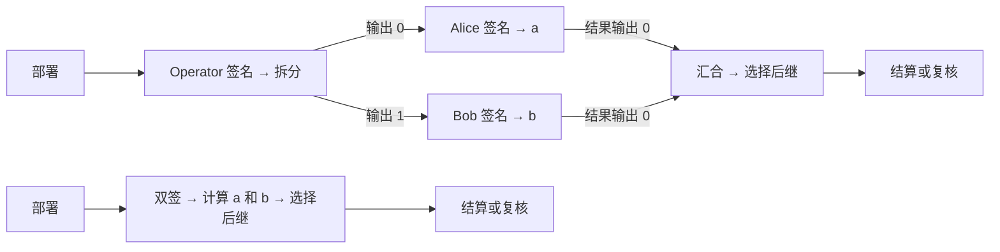

# 4thGraph

A Forth compiler for BSV Script and multi-transaction workflows.

当前构建版本为 **v0.2.7**。编译与复放产物可写入 `projects/4thgraph/build/`。

同一份 Forth 源码可以生成融合版和拆分版。示例计算 `a = 2x`、`b = y + 1`，两支结果和汇合的和都按 `u32` 表示。回绕后的和小于 20 时走复核，其余走结算。两种后继各锁给一个配置的公钥。编译器以 Forth 2012 Core 为语义基线，`+` 使用 64 位 cell，`u32+` 固定按 32 位回绕。 [示例源码](example.fth) · [语言与 BSV 扩展规范](language.md)

## 复放与编译

从仓库根目录运行。Node 启动器创建临时、无对等节点的 regtest，下载并校验 BSV Node 1.2.3。

```sh
python -m venv .venv
. .venv/bin/activate
python -m pip install ecdsa -r shared/requirements-chronicle.txt
PYTHONPATH=. python -m unittest discover -v -s projects/4thgraph
PYTHONPATH=. bash shared/verify_node.sh --profile default -- \
  python projects/4thgraph/replay.py --output projects/4thgraph/build/replay.json --samples 21
```

编译和复放都用 `--target` 选目标。三个目标均使用原始 ForkID ALL（`0x41`）。

| 目标 | 合约锁接受的版本 | 实例化默认版本 |
| --- | --- | --- |
| `forkid-v1` | v1 | v1 |
| `chronicle-v2`（默认） | v2 | v2 |
| `both` | v1、v2 | v2 |

用 `both` 部署后，可为各步独立选择版本，例如 `Contracts.prepare("a", completed, {"x": 10}, version=1)`。同一工作流可以用 v1 和 v2 的结果共同汇合。各锁核对当前交易的版本，汇合还核对两笔结果父交易各自的版本。若已有部署仅接受单一版本，扩大版本集合需要重新部署。版本 1 和双版本模式依赖 BSV Genesis 的 Script 运算和大栈元素能力。

把 regtest 激活高度设到样本区块之后，可复放 Chronicle 激活前的路径：

```sh
REGTEST_CHRONICLE_HEIGHT=1000 PYTHONPATH=. bash shared/verify_node.sh --profile default -- \
  python projects/4thgraph/replay.py --target forkid-v1 --output projects/4thgraph/build/replay-v1.json --samples 21

PYTHONPATH=. bash shared/verify_node.sh --profile default -- \
  python projects/4thgraph/replay.py --target both --output projects/4thgraph/build/replay-both.json --samples 21
```

复放 JSON 保存源码、两套脚本和符号模板、每笔交易的原始字节与真实 outpoint、每个输入的 BSV Node 脚本判定、Node 入池及挖块结果，以及 chain-gang 的整笔交易判定。启动时使用钱包矿工奖励建立共享资金夹具。报告从各路径自己的部署交易开始计量。

可用复放报告里的测试公钥离线编译。换用自己的公钥时，`keys.json` 的格式为角色名到压缩 secp256k1 公钥十六进制字符串的映射。编译会验证每个必需角色的公钥确实对应曲线上的点。

```sh
jq '.fixture_public_keys' projects/4thgraph/build/replay.json > projects/4thgraph/build/fixture-keys.json
PYTHONPATH=. python projects/4thgraph/protocol.py projects/4thgraph/example.fth \
  --mode split --target both --keys projects/4thgraph/build/fixture-keys.json --task-id "$(jq -r .task_id projects/4thgraph/build/replay.json)"
PYTHONPATH=. python projects/4thgraph/protocol.py --capabilities
```

### 编译公开状态关系

`relation: advance decide ;` 指定一个 `u32 -- u32` 转换词和一个 `u32 -- route` 路由词。构建器从同一次源码解析取得两个词，将初始状态固定在锁中，核对花费的实际后继付款和状态回执。分文件定义可用 `REQUIRE` 导入。[完整示例](examples/verify-state.fth)

```sh
project=projects/4thgraph
app=$project/examples/verify-state.fth
keys=$project/build/fixture-keys.json
PYTHONPATH=. python "$project/protocol.py" "$app" --keys "$keys" --current 19
PYTHONPATH=. python "$project/circuit_backend.py" "$app" --output "$project/build/relation.circom"
PYTHONPATH=. python "$project/verification.py" "$app" --keys "$keys" --current 19 --policy require-proof
```

默认构建生成直接验证的 Script 并报告 Circom 编译结果。`require-proof` 启用由同一电路生成的透明 R1CS 证明。`--policy require-groth16 --groth16 ZKEY PHASE2_PTAU` 选择 BLS12-381 Groth16，并核对设置文件与生成的 R1CS。`--max-lock-bytes` 在选择候选前限制锁长，`--max-expanded-ops` 限制词展开。证明后端使用 Node.js、npx 和固定版本的 Circom 与 snarkjs。用 `shared/verify_node.sh --profile raised --` 运行上述 `verification.py` 命令并附加 `--replay`，可重跑实际花费。

只有词定义的电路源文件须用 `circuit_backend.py SOURCE --entries TRANSITION ROUTE --output FILE` 显式指定入口。含阶段声明的工作流由阶段依赖决定入口。

`--mode auto` 在所有输入和分支授权都可同时取得时选融合。可用 `--available-data x` 或 `--available-authorizers alice` 模拟另一支晚到。往示例末尾加上 `independent-submit: a ;` 后，`auto` 选择拆分，`--mode fused` 报告约束的源文件行号。可显式请求拆分，在两种调度都合法时做同源对照。

## 编译决策报告

`protocol.py --explain` 给出候选交易图、可用性假设、逐词改写和选择理由。`replay.py` 的复放格式 2 将原始源码的融合、拆分和带约束的拆分各跑一次结算和复核。六条路径各带其实际使用的构建摘要。

以下命令从仓库根目录生成首份对照。已有 v0.1.0 归档时，会一起收录为历史基线。

```bash
project=projects/4thgraph
PYTHONPATH=. bash shared/verify_node.sh --profile default -- \
  python "$project/replay.py" --target both --optimize stack --join-witness shared \
  --output "$project/build/decision-replay.json"

archives=()
for path in "$project"/build/v0.1.0-*parallel-*.json; do
  if [[ -f "$path" ]]; then
    archives+=(--baseline "$path")
  fi
done
PYTHONPATH=. python "$project/decision_report.py" "$project/build/decision-replay.json" \
  --output-dir "$project/build/decision" "${archives[@]}"
```

报告器离线生成 `decision-report.json` 和 `decision-report.md`。评估另一拓扑时，为复放加上 `--topology gated-parallel`。复审相关的有资金回归可以在独立的 regtest 实例运行。

```sh
PYTHONPATH=. bash shared/verify_node.sh --profile default -- \
  python -m unittest discover -v -s projects/4thgraph -p test_regtest.py
```

## 有界候选搜索

`protocol.py --search --explain` 对同一份源码与可用性假设生成候选和选择。带门拓扑最多有五个候选。融合占一个，拆分将门合并或单独提交的两种边界与 `full`、`shared` 两种汇合见证交叉比较。可用 `--mode split`、`--gate-boundary merged|separate` 或 `--join-witness full|shared` 缩小范围。显式门边界也可用于普通构建，便于复现对应候选的摘要。

`--objective path-bytes` 默认按整路字节排序。`--objective peak-validation` 优先降低单笔最大原生签名检查次数，再比较峰值输入脚本字节。报告同时列出结算和复核在 BSV Node 与 chain-gang 的实测耗时。

```sh
project=projects/4thgraph
PYTHONPATH=. bash shared/verify_node.sh --profile default -- \
  python "$project/replay.py" --search --topology gated-parallel --target both \
  --optimize stack --samples 7 --output "$project/build/search-replay.json"
PYTHONPATH=. python "$project/decision_report.py" "$project/build/search-replay.json" \
  --output-dir "$project/build/search-decision"
```

## 语言与运行器

- `: inc-cell ( cell -- cell ) 1 + ;` 在定义中声明静态栈效果。受支持的 Core Extension 词默认启用。构建会报告无法编译到 Script 的用法及源码位置。
- `work: a x double alice ;` 将输入、计算和签名角色连到工作步骤。 `join: route a b decide ;` 按指定顺序声明汇合依赖。 `split-authority: operator ;` 声明启动拆分的签名角色。当前调度器识别一对并行分支和一个汇合。选择交易边界后，后端再内联、折叠字面量和选择 Script 指令。
- 若把第二支改为 `work: b x inc bob ;`，两支都使用同一个 `x`。融合版只需提供一次。拆分版在创建工作输出时锁定 `x`，Alice 和 Bob 之后可各自提交，其签名请求绑定包含该值的实际前输出。若独立的门也使用 `x`，提供它的时点提前到门交易。共享值以明文进入相应的锁脚本。
- 词库声明执行位置和验证依据。Script 词由链上执行。宿主词通过 `Host` 的注入接口查询 UTXO、请求签名和提交交易，并可从 UTXO 取得脚本和 outpoint。测试签名器使用公开可复现的私钥，仅供 regtest。
- `Contracts.prepare` 把符号引用如 `split:0` 解析为已封装父交易的真实 outpoint，核对前输出、已提供的父交易关系，以及汇合结果的槽位、同次拆分来源和编码。含门条件的步骤会先在宿主检查条件。 `Draft.signing_requests` 给外部签名器提供角色、前输出、待签交易、见证输入及 ForkID ALL 摘要。 `Draft.seal` 校验草稿绑定并装配签名和当前交易原像。实际可花费性仍由 UTXO 集和链上脚本验证。父 txid 改变时，`invalidated` 沿依赖图列出需重新绑定的交易和需更新的授权。

## 交易与验证

`example.fth` 是并行双分支。`gated.fth` 在分支前有一道授权条件。后者可以完整融合、把条件与拆分合并，或将条件交易独立提交后由拆分绑定其输出。`independent-submit: qualify ;` 强制最后一种计划。两个示例共用汇合验证和版本选择。 [带门的源码](gated.fth)

```sh
PYTHONPATH=. bash shared/verify_node.sh --profile default -- \
  python projects/4thgraph/replay.py --topology gated-parallel --target both \
  --optimize stack --join-witness shared --output projects/4thgraph/build/gated.json
```



**融合。** 双方对同一笔交易授权。锁在一次 Script 执行中计算两支、在栈上汇合，并按选择验证后继输出的锁和金额。

**拆分。** 启动锁验证有序的两个工作输出。每支只需自己的数据和签名即可花费对应工作输出。工作锁用真实输入的拆分 txid 构造结果锁，并验证第二个输出发布了正确的结果。结果是五字节 ScriptNum，包含四字节无符号值和零符号字节。结果数据附在零值 `OP_FALSE OP_RETURN` 输出上。

**汇合。** 两个输入的锁都接收完整的两笔结果父交易。各自检查它们花费了同一笔拆分的输出 0 和 1，再将两笔父交易的哈希和结果 vout 0 拼成有序的 outpoint 向量，与真实交易原像的 `hashPrevouts` 核对。两个锁都从已核验的交易字节取结果，并检查有且仅有一个正确后继输出。任务 ID 只标识结果数据。活动 UTXO 集决定实际可花费的结果。

各锁通过固定 `OP_CODESEPARATOR` 后缀的 PUSHTX 验证 ForkID ALL 原像。绑定依赖哈希抗碰撞和原像抗性。脚本读取经过认证的交易版本四字节，v1 对应 `01000000`，v2 对应 `02000000`。原型使用普通压栈见证和单值成功栈。签名覆盖交易效果，见证里的原始 `x/y` 可由导出同一已签效果的等价输入替换。拆分后任一方可以独立提交自己的分支，正常汇合要等两支结果。

### 超时退出

源码可用 `recovery: 145 review` 声明绝对区块高度和退款签名角色。调用 `Contracts.prepare_refund` 时传入原交易步骤和 vout。状态报告从实际存活的 outpoint 列出下一步、所需角色和各退款金额。示例中的退出需由 `review` 签名，角色可用性影响实际恢复。

| 当前已确认状态 | 正常推进 | 高度 145 后可花费的退款输入 |
| --- | --- | --- |
| 仅部署 | Operator 拆分 | `deploy:0` |
| 两份工作输出 | Alice 和 Bob 各花费自己的工作输出 | `split:0`、`split:1` |
| Alice 有结果，Bob 缺席 | Bob 可继续计算 | `a:0`、`split:1` |
| 两份结果 | 任何持有两份结果的提交者可汇合 | `a:0`、`b:0` |
| Alice 结果已退出 | Bob 的剩余工作输出或结果仍可各自花费 | 存活的 `split:1` 或 `b:0` |

BSV Node 1.2.3 可在到期前把签名正确的退款放进非最终池。该笔退款无法提前花费链上输出。复放中，节点以 `txn-mempool-conflict` 拒绝与它冲突的正常汇合，并在到期后仍把重发的原交易报告为已在池中。状态报告的 `height_reached` 表示链上高度条件已满足。报告同时记录节点队列和入池结果。两种未预先排队的到期竞态各在独立工作流内复放，首笔确认的交易消耗共同的结果 outpoint。

```sh
PYTHONPATH=. bash shared/verify_node.sh --profile default -- \
  python projects/4thgraph/recovery_replay.py --target both \
  --output projects/4thgraph/build/v0.1.4-recovery-both.json
```

## 测量

v0.0.2 的可选 `safe` 后端将示例 `inc` 从 70 B 降到 8 B，`decide` 从 18 B 降到 16 B。v0.0.3 的匹配算术基准中，BIP340 循环中的点和从 216 B 降到 149 B。通用调度器生成的 P-256 点加与倍点为 170 B 和 98 B，专用参考分别为 147 B 和 76 B。通用后端仅在生成字节更少时替换基本块。

`kernel_bench.py` 通过 `--schnorr-reference` 接收固定提交的 `reference` 目录，内置两个源文件的摘要。它对三组匹配内核做数据差分，再构造完整 regtest 交易，用两个引擎核对结果和记录两栈峰值。 [Schnorr 固定提交](https://github.com/linzhm/bsv-script-lab/tree/a1f4485ba84bbc2211be75316626f9ac76636197/projects/p2pkh-schnorr/reference)

v0.1.3 在 `stack` 后端加入局部操作数调度。典型节省来自把已就位的末次使用槽直接交给运算，或用一条指令搬运成对槽位。相同算式和输入的对照如下。栈峰值在每组 153 个内核输入上测量，单位为实际字节载荷。

| 内核 | 专用参考 B | 旧通用调度 B | 新通用调度 B | 新 / 旧主栈峰值 B | 新 / 旧 Alt 栈峰值 B |
| --- | ---: | ---: | ---: | ---: | ---: |
| P-256 点加 | 147 | 170 | 142 | 869 / 869 | 0 / 0 |
| P-256 倍点 | 76 | 98 | 85 | 714 / 714 | 0 / 0 |
| BIP340 循环点加 | 216 | 149 | 129 | 682 / 682 | 0 / 0 |

专用倍点可针对公式内嵌中间表达式及域常数读取，目前仍少 9 B。基准对每种实现各复放一笔完整正向花费，并测试零模数和缺少输入。JSON 记录源码摘要、内核与完整交易的两栈峰值，以及双引擎结果。

```sh
PYTHONPATH=. bash shared/verify_node.sh --profile default -- \
  python projects/4thgraph/kernel_bench.py --schnorr-reference "$schnorr_reference" \
  --output projects/4thgraph/build/v0.1.3-kernels.json
```

下表是 `chronicle-v2` 的一次样本，使用 BSV Node 1.2.3 默认 regtest 配置及 chain-gang `74676b9`。每笔正向交易重复验证 21 次，取中位数，再在路径上取最大值。Node 耗时含本地 RPC 往返，chain-gang 耗时含解析。栈峰值来自开发求值器对已通过两引擎的输入进行剖析，模拟原生签名检查并按字节值载荷计量。合计峰值取同一采样点的两栈之和。

| 路径 | 整条路径 B | 部署后 B | 交易数 | 依赖深度含部署 | 中间 UTXO | 主栈 / Alt / 合计峰值 B | 最大单笔 Node RPC ms | 最大单笔 chain-gang ms |
| --- | ---: | ---: | ---: | ---: | ---: | ---: | ---: | ---: |
| 融合结算 | 1,477 | 404 | 2 | 2 | 0 | 493 / 158 / 620 | 0.82 | 0.31 |
| 融合复核 | 1,483 | 409 | 2 | 2 | 0 | 497 / 158 / 624 | 0.89 | 0.31 |
| 拆分结算 | 13,074 | 12,208 | 5 | 4 | 4 | 5,312 / 159 / 5,471 | 1.14 | 0.26 |
| 拆分复核 | 13,093 | 12,226 | 5 | 4 | 4 | 5,328 / 163 / 5,486 | 1.25 | 0.26 |

中间 UTXO 计入两个工作输出和两个结果输出。零值结果数据输出在创建时即不可花费。签名字节数和耗时会随运行变化。此夹具的融合版整条路径约为拆分版的九分之一，拆分的主要尺寸开销是每个汇合输入携带两笔完整结果交易。

每种目标的四条路径都已在 regtest 挖块并通过 chain-gang 的逐交易验证。v1 和双版本目标都在 Chronicle 激活前、后复放。双版本目标在同一条拆分路径里混用 v1、v2，两个工作槽和汇合交易都各自复放过两种版本。复核路径先发 Bob 分支，结算路径先发 Alice 分支。下表列出汇合负向复放。

| 场景 | BSV Node | chain-gang |
| --- | --- | --- |
| 完整汇合引用尚未提交的第二个结果 | 提供两份父交易脚本时，两个输入各自通过。提交整笔交易时报告缺少输入。 | 在只有已存在父交易的上下文中拒绝 |
| 汇合少一个输入 | 输入脚本拒绝，整笔交易也违反金额守恒 | 拒绝 |
| 另一次真实拆分产生的结果，任务 ID 相同 | 全部父输出可花费，两个结果锁拒绝 | 拒绝 |
| 选择错误的后继锁 | 全部父输出可花费，两个结果锁拒绝 | 拒绝 |
| 用该目标未允许的交易版本提交汇合 | 全部父输出可花费，两个结果锁拒绝 | 拒绝 |

## 链上验证算术证明

`proof/counter.circom` 定义 32 位计数器。Circom 2.2.2 生成固定的 BN254 R1CS 和 WASM，snarkjs 0.7.5 生成并独立检查每条赋值证明。验证数据是导出的 R1CS 及其摘要。证明公开完整赋值，采用透明验证，无需可信设置。

4thGraph 把 R1CS 约束和 `proof/counter.fth` 中的后继选择一起编译进锁。锁验证当前值与部署承诺一致，并要求新值写入实际后继输出。公开绑定是完整、经认证的 ForkID ALL 原像的 `HASH256`，其中包含版本、outpoint、序列、后继输出和锁定时间。另一笔花费或改动锁定时间后，原证明中的公开绑定会失配。优化版复用域模数，并简化零乘积、单位系数和可居中表示的系数。

```sh
PYTHONPATH=. bash shared/verify_node.sh --profile default -- \
  python projects/4thgraph/proof_replay.py --target both \
  --output projects/4thgraph/build/v0.1.5-proof-both-2.json
```

报告含基线与优化版的脚本、正向完整交易、两栈峰值、验证耗时，以及改动赋值、错误当前值、错误后继和跨花费重用的判定。复放会调用固定版本的 npm 工具生成验证数据。已有 snarkjs 的 R1CS JSON 时，也可用 `proof_contract.py --verification-key` 单独构建。

### 从 Forth 生成约束

工作流、验证声明和 Gforth 计数器通过 `REQUIRE` 共用 `proof/counter.fth` 中的 `advance` 和 `decide`。同一份定义用于宿主求值、Script 和 Circom。后端把 32 位回绕显式编码为进位和范围约束，用 33 位分解确定无符号比较结果。复放继续用固定版本的 snarkjs 计算并检查赋值。锁还校验电路公布的路由与 Forth 生成的后继选择一致。

该示例生成 107 条约束。Chronicle 激活后的双版本样本中，完整验证锁从 9,196 B 降到 4,481 B。复放对照覆盖普通输入、18 和 19 跨越分支阈值，以及 4,294,967,295 回绕到 0。

```sh
project=projects/4thgraph
PYTHONPATH=. python "$project/circuit_backend.py" "$project/proof/workflow.fth" \
  --output "$project/build/workflow.circom"
PYTHONPATH=. bash shared/verify_node.sh --profile default -- \
  python "$project/proof_replay.py" --generated --compare-domains --target both \
  --output "$project/build/v0.2.0-circuit-both-2.json"
```

## Groth16 链上验证器

[固定声明的 nChain 对照](benchmarks/nchain-fixed/README.md) · [动态、混合和固定输入的同基线对照](benchmarks/groth16-inputs/README.md)

### BLS12-381

`groth16_bls12381.py` 从 snarkjs 验证密钥和公开输入配置生成 BSV 锁。对每个公开输入，JSON 配置用十进制标量固定部署时的值，用 `null` 表示完整 Fr 范围的花费时输入，也可用 `{"bits":128}` 限定为无符号 128 位。混合配置把固定项折叠进 `IC` 累加器，Script 使用两位固定基点窗口计算其余项并校验所声明的仿射 MSM 点。全固定配置预计算完整的公开输入配对项。

Script 检查坐标范围、曲线方程、素数阶子群和配对关系。Miller 循环用 Jacobian 坐标，并将余数幂合入循环。余数检查替代最终指数运算，见证省去斜率和逆元。全固定配置使用 960 B 证明数据包加 3 B push 编码。数据包包含 `A.x, A.y, B.x0, B.x1, B.y0, B.y1, C.x, C.y` 及 Fp12 余数。每个 Fp 元素用 48 B 无符号小端编码。余数先编码 w 的偶次幂系数，再编码奇次幂系数，每个 Fp2 系数按实部、虚部顺序。

动态和混合路径在证明包末尾追加 96 B 的 MSM 声明，接着单独 push 一个公开输入包。公开输入包按验证密钥槽顺序编码花费时提供的标量，每项是按所声明位宽向上取整到整字节的无符号小端数。范围是 `[0, min(2^bits, R))`。无穷远 MSM 点用两个零坐标表示。

原始验证锁可直接组合应用检查。示例 `bind_public_output` 用 ForkID ALL 原像验证真实后继输出的金额和状态字节，再把同一个公开输入包交给证明谓词。选择 `--owner` 时，在见证后追加对完整锁签出的 DER 签名和 `0x41`，由该签名授权交易。

同一份字节码支持 Genesis 和 Chronicle 下的 v1、v2 交易。用 BLS12-381 格式的 snarkjs 文件构建锁和见证。

```sh
project=projects/4thgraph
PYTHONPATH=. python "$project/groth16_bls12381.py" \
  --verification-key verification_key.json --public public.json \
  --owner "$owner_public_key_hex" --output lock.json \
  --proof proof.json --witness-output witness.hex
```

`--public` 单独使用时编译固定声明。动态或混合构建使用 `--input-sources input-sources.json`，生成见证时再传 `--public` 和 `--proof`。省略两种公开输入选项会生成完整 Fr 范围的动态锁。动态和混合路径可用 `--stack-schedule baseline` 对照默认的紧凑栈调度。

测试夹具来自 `proof/workflow.fth`，使用 `circom2@0.2.22 --prime bls12381` 和 `snarkjs@0.7.5` 的本地测试专用设置。签名密钥也是测试专用。已导出的夹具让完整复放无需重新出证，同一个程序可分别复放 v1 和 v2。

```sh
project=projects/4thgraph
PYTHONPATH=. bash shared/verify_node.sh --profile raised -- \
  python "$project/groth16_bls12381_replay.py" --tx-version 2 \
  --output "$project/build/groth16-bls12381-v2.json"
```

设置 `REGTEST_CHRONICLE_HEIGHT=1000` 可复放 Chronicle 激活前的完整交易。报告包含脚本与交易字节、双引擎判定及验证时长、开发求值器的两栈载荷峰值，以及实际挖块结果。

此夹具的锁为 **279,463 B**，v2 花费为 **1,132 B**。在 `raised` 配置下，四种时代与版本组合各复放一次有效花费及九个拒绝用例。默认配置下有效 v2 花费也能入块，完整反例复放的 `verifyscript` RPC 遇到 3 ms 超时。

CCTP 的动态公开输入原型使用同一 Forth 源码生成融合、双输入和串行布局，并复放同一密钥和证明的 zkscript 外部基线。[VK_x 交易边界与重跑命令](cctp/README.md)

### BN254 参考

`groth16_script.py` 把 BN254 的 snarkjs 验证密钥和五个预期公开信号编译成一个 BSV 锁。锁中固定验证密钥和公开信号。Rúnar 的配对验证使用随证明提供的辅助算术见证，Script 核验这些见证及 Groth16 配对关系。锁还要求所有者提供 ForkID ALL 签名，由该签名覆盖真实交易的输入和输出。Forth 示例的信号顺序为 `next`、`route`、`current`、`bindLo`、`bindHi`。

此验证器使用 Chronicle 操作码。部署锁约 1.52 MB，算术见证约 31 KB。下面的本地复放使用 `raised` 节点配置和独立的钱包资金。要观察激活前的拒绝，可设置 `REGTEST_CHRONICLE_HEIGHT=1000`。

以下命令用现有 Forth 电路生成测试专用 Groth16 密钥和证明，然后复放有资金的部署与花费。需要 Node.js、npm 和 Go 1.26.6。Rúnar 检出固定提交，证明工具沿用本项目固定的 Circom 和 snarkjs。

```sh
project=projects/4thgraph
runar="$project/build/runar"
git clone https://github.com/icellan/runar.git "$runar"
git -C "$runar" checkout --detach dbcc4269f8e0895c4738cf86948b05b7d62a2010
PYTHONPATH=. bash shared/verify_node.sh --profile raised -- \
  python "$project/groth16_replay.py" --runar "$runar" \
  --output "$project/build/groth16-verifier-v2.json"
```

已持有验证密钥时，用 `groth16_script.py --runar DIR --verification-key verification_key.json --public expected.json --owner HEX --output lock.json` 生成锁。`expected.json` 是由部署方确定的五个公开标量。加 `--proof proof.json --witness-output witness.hex` 会导出 push-only 解锁前缀。花费时在前缀后追加对完整锁脚本生成的 DER 签名及 `0x41`。复放报告同时记录测试专用设置、Script 字节、两独立引擎判定和 regtest 挖块结果。

## 链上编译器里程碑

用 PELS counter 验证下一步。让有界的 Script 编译器计算确定性的后继脚本或符号交易计划，让部署输出承诺该编译结果。计划先编码 `(父步骤, vout)`，部署交易最终字节和 txid 确定后再绑定真实 outpoint 和授权。这样部署承诺的对象在部署 txid 出现前就能确定。当前原型完成宿主侧编译、绑定和复放。
