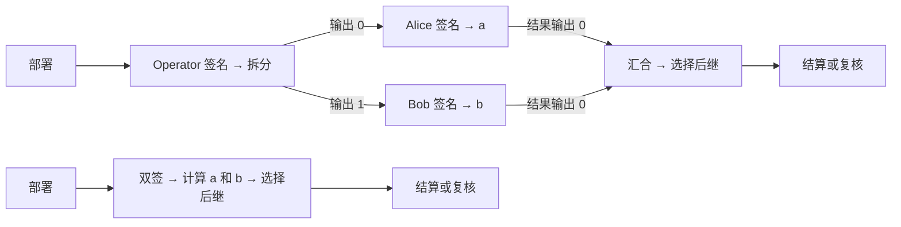

# BSV Forth 与多交易编译器

[example.fth](example.fth) 的同一份程序可以生成融合版和拆分版。示例计算 `a = 2x`、`b = y + 1`，每次加法都按 `u32` 回绕。回绕后的 `a + b` 小于 20 时走复核，其余走结算。两种后继各锁给一个配置的公钥。

## 复放与编译

从仓库根目录运行。Node 启动器创建临时、无对等节点的 regtest，下载并校验 BSV Node 1.2.3。

```sh
python -m venv .venv
. .venv/bin/activate
python -m pip install ecdsa -r shared/requirements-chronicle.txt
PYTHONPATH=. python -m unittest discover -v -s projects/forth-multi-tx
PYTHONPATH=. bash shared/verify_node.sh --profile default -- \
  python projects/forth-multi-tx/replay.py --output /tmp/forth-replay.json --samples 21
```

复放 JSON 保存源码、两套脚本和符号模板、每笔交易的原始字节与真实 outpoint、每个输入的 BSV Node 脚本判定、Node 入池及挖块结果，以及 chain-gang 的整笔交易判定。启动时使用钱包矿工奖励建立共享资金夹具。报告从各路径自己的部署交易开始计量。

可用复放报告里的测试公钥离线编译。换用自己的公钥时，`keys.json` 的格式为角色名到压缩 secp256k1 公钥十六进制字符串的映射。

```sh
jq '.fixture_public_keys' /tmp/forth-replay.json > /tmp/forth-keys.json
PYTHONPATH=. python projects/forth-multi-tx/protocol.py projects/forth-multi-tx/example.fth \
  --mode split --keys /tmp/forth-keys.json --task-id "$(jq -r .task_id /tmp/forth-replay.json)"
```

`--mode auto` 在所有输入和分支授权都可同时取得时选融合。可用 `--available-data x` 或 `--available-authorizers alice` 模拟另一支晚到。往示例末尾加上 `a independent-submit` 后，`auto` 选择拆分，`--mode fused` 报告约束的源文件行号。可显式请求拆分，在两种调度都合法时做同源对照。

## 语言与运行器

- `: name ( inputs -- outputs ) words ;` 声明静态栈签名。支持 `dup`、`drop`、`swap`、`over`、`if … else … then`、定宽 `u32`、字节串字面值，以及少量算术和哈希词。条件两支必须留下同型栈。解析完成后选择交易边界，再内联、折叠字面量和选择 Script 指令。
- `x double alice work: a` 将输入、计算和签名角色连到工作步骤。 `a b decide join: route` 按指定顺序声明汇合依赖。 `operator split-authority` 声明启动拆分的签名角色。当前调度器识别一对并行分支和一个汇合。
- 词库声明执行位置和验证依据。Script 词由链上执行。宿主词通过 `Host` 的注入接口查询 UTXO、请求签名和提交交易，并可从 UTXO 取得脚本和 outpoint。测试签名器使用公开可复现的私钥，仅供 regtest。
- `Contracts.prepare` 把符号引用如 `split:0` 解析为已封装父交易的真实 outpoint。 `Draft.signing_requests` 给外部签名器提供角色、前输出、待签交易、见证输入及 ForkID ALL 摘要。 `Draft.seal` 装配签名和当前交易原像。父 txid 改变时，`invalidated` 沿依赖图列出需重新绑定的交易和需更新的授权。拆分 txid 改变会让 Alice 与 Bob 重新签名，汇合也要重建见证。

## 交易与验证



**融合。** 双方对同一笔交易授权。锁在一次 Script 执行中计算两支、在栈上汇合，并按选择验证后继输出的锁和金额。

**拆分。** 启动锁验证有序的两个工作输出。每支只需自己的数据和签名即可花费对应工作输出。工作锁用真实输入的拆分 txid 构造结果锁，并验证第二个输出发布了正确的结果。结果是五字节 ScriptNum，包含四字节无符号值和零符号字节。结果数据附在零值 `OP_FALSE OP_RETURN` 输出上。

**汇合。** 两个输入的锁都接收完整的两笔结果父交易。各自检查它们花费了同一笔拆分的输出 0 和 1，再将两笔父交易的哈希和结果 vout 0 拼成有序的 outpoint 向量，与真实交易原像的 `hashPrevouts` 核对。两个锁都从已核验的交易字节取结果，并检查有且仅有一个正确后继输出。任务 ID 只标识结果数据。活动 UTXO 集决定实际可花费的结果。

各锁通过固定 `OP_CODESEPARATOR` 后缀的 PUSHTX 验证 ForkID ALL 原像。绑定依赖哈希抗碰撞和原像抗性。脚本读取经过认证的交易版本四字节 `02000000`。所有业务输出都在 Chronicle 激活后创建。原型使用普通压栈见证和单值成功栈。签名覆盖交易效果，见证里的原始 `x/y` 可由导出同一已签效果的等价输入替换。拆分后任一方可以独立提交自己的分支，最终资金仍要等两支结果。当前模板没有超时和退款交易。

## 测量

BSV Node 1.2.3 默认 regtest 配置及 chain-gang `74676b9`。每笔正向交易重复验证 21 次，取中位数，再在路径上取最大值。Node 耗时含本地 RPC 往返，chain-gang 耗时含解析。栈峰值来自开发求值器对已通过两引擎的输入进行剖析，模拟原生签名检查并按字节值载荷计量。合计峰值取同一采样点的两栈之和。

| 路径 | 整条路径 B | 部署后 B | 交易数 | 依赖深度含部署 | 中间 UTXO | 主栈 / Alt / 合计峰值 B | 最大单笔 Node RPC ms | 最大单笔 chain-gang ms |
| --- | ---: | ---: | ---: | ---: | ---: | ---: | ---: | ---: |
| 融合结算 | 1,415 | 405 | 2 | 2 | 0 | 494 / 158 / 621 | 0.77 | 0.34 |
| 融合复核 | 1,419 | 409 | 2 | 2 | 0 | 497 / 158 / 624 | 0.76 | 0.31 |
| 拆分结算 | 12,900 | 12,034 | 5 | 4 | 4 | 5,261 / 159 / 5,420 | 1.10 | 0.28 |
| 拆分复核 | 12,916 | 12,049 | 5 | 4 | 4 | 5,274 / 163 / 5,432 | 1.13 | 0.32 |

中间 UTXO 计入两个工作输出和两个结果输出。零值结果数据输出在创建时即不可花费。签名字节数和耗时会随运行变化。此夹具的融合版整条路径约为拆分版的九分之一，拆分的主要尺寸开销是每个汇合输入携带两笔完整结果交易。

四条路径都已在 regtest 挖块并通过 chain-gang 的逐交易验证。复核路径先发 Bob 分支，结算路径先发 Alice 分支。汇合负向复放包括：

| 场景 | BSV Node | chain-gang |
| --- | --- | --- |
| 完整汇合引用尚未提交的第二个结果 | 提供两份父交易脚本时，两个输入各自通过。提交整笔交易时报告缺少输入。 | 在只有已存在父交易的上下文中拒绝 |
| 汇合少一个输入 | 输入脚本拒绝，整笔交易也违反金额守恒 | 拒绝 |
| 另一次真实拆分产生的结果，任务 ID 相同 | 全部父输出可花费，两个结果锁拒绝 | 拒绝 |
| 选择错误的后继锁 | 全部父输出可花费，两个结果锁拒绝 | 拒绝 |

## 链上编译器里程碑

用 PELS counter 验证下一步。让有界的 Script 编译器计算确定性的后继脚本或符号交易计划，让部署输出承诺该编译结果。计划先编码 `(父步骤, vout)`，部署交易最终字节和 txid 确定后再绑定真实 outpoint 和授权。这样部署承诺的对象在部署 txid 出现前就能确定。当前原型完成宿主侧编译、绑定和复放。
