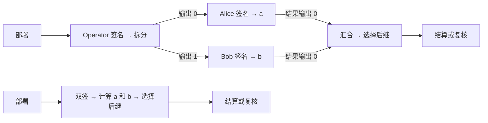

# 4thGraph

A Forth compiler for BSV Script and multi-transaction workflows.

当前构建版本为 **v0.1.1**。项目位于 BSV Script Lab 仓库内，编译与复放产物可写入 `projects/forth-multi-tx/build/`。

同一份 Forth 源码可以生成融合版和拆分版。示例计算 `a = 2x`、`b = y + 1`，两支结果和汇合的和都按 `u32` 表示。回绕后的和小于 20 时走复核，其余走结算。两种后继各锁给一个配置的公钥。编译器以 Forth 2012 Core 为语义基线，`+` 使用 64 位 cell，`u32+` 固定按 32 位回绕。 [示例源码](example.fth) · [语言与 BSV 扩展规范](language.md)

## 复放与编译

从仓库根目录运行。Node 启动器创建临时、无对等节点的 regtest，下载并校验 BSV Node 1.2.3。

```sh
python -m venv .venv
. .venv/bin/activate
python -m pip install ecdsa -r shared/requirements-chronicle.txt
PYTHONPATH=. python -m unittest discover -v -s projects/forth-multi-tx
PYTHONPATH=. bash shared/verify_node.sh --profile default -- \
  python projects/forth-multi-tx/replay.py --output projects/forth-multi-tx/build/replay.json --samples 21
```

编译和复放都用 `--target` 选目标。三个目标均使用原始 ForkID ALL（`0x41`）。

| 目标 | 合约锁接受的版本 | 实例化默认版本 |
| --- | --- | --- |
| `forkid-v1` | v1 | v1 |
| `chronicle-v2`（默认） | v2 | v2 |
| `both` | v1、v2 | v2 |

用 `both` 部署后，可为各步独立选择版本，例如 `Contracts.prepare("a", completed, {"x": 10}, version=1)`。同一工作流可以用 v1 和 v2 的结果共同汇合。各锁核对当前交易的版本，汇合还核对两笔结果父交易各自的版本。若已有部署仅接受单一版本，扩大版本集合需要重新部署。版本 1 和双版本模式依赖 BSV Genesis 的 Script 运算和大栈元素能力。

把 regtest 激活高度设到样本区块之后，可复放 Chronicle 激活前的路径：

```sh
REGTEST_CHRONICLE_HEIGHT=1000 PYTHONPATH=. bash shared/verify_node.sh --profile default -- \
  python projects/forth-multi-tx/replay.py --target forkid-v1 --output projects/forth-multi-tx/build/replay-v1.json --samples 21

PYTHONPATH=. bash shared/verify_node.sh --profile default -- \
  python projects/forth-multi-tx/replay.py --target both --output projects/forth-multi-tx/build/replay-both.json --samples 21
```

复放 JSON 保存源码、两套脚本和符号模板、每笔交易的原始字节与真实 outpoint、每个输入的 BSV Node 脚本判定、Node 入池及挖块结果，以及 chain-gang 的整笔交易判定。启动时使用钱包矿工奖励建立共享资金夹具。报告从各路径自己的部署交易开始计量。

可用复放报告里的测试公钥离线编译。换用自己的公钥时，`keys.json` 的格式为角色名到压缩 secp256k1 公钥十六进制字符串的映射。编译会验证每个必需角色的公钥确实对应曲线上的点。

```sh
jq '.fixture_public_keys' projects/forth-multi-tx/build/replay.json > projects/forth-multi-tx/build/fixture-keys.json
PYTHONPATH=. python projects/forth-multi-tx/protocol.py projects/forth-multi-tx/example.fth \
  --mode split --target both --keys projects/forth-multi-tx/build/fixture-keys.json --task-id "$(jq -r .task_id projects/forth-multi-tx/build/replay.json)"
PYTHONPATH=. python projects/forth-multi-tx/protocol.py --capabilities
```

`--mode auto` 在所有输入和分支授权都可同时取得时选融合。可用 `--available-data x` 或 `--available-authorizers alice` 模拟另一支晚到。往示例末尾加上 `independent-submit a` 后，`auto` 选择拆分，`--mode fused` 报告约束的源文件行号。可显式请求拆分，在两种调度都合法时做同源对照。

## 编译决策报告

`protocol.py --explain` 给出候选交易图、可用性假设、逐词改写和选择理由。`replay.py` 的复放格式 2 将原始源码的融合、拆分和带约束的拆分各跑一次结算和复核。六条路径各带其实际使用的构建摘要。

以下命令从仓库根目录生成首份对照。已有 v0.1.0 归档时，会一起收录为历史基线。

```bash
project=projects/forth-multi-tx
PYTHONPATH=. bash shared/verify_node.sh --profile default -- \
  python "$project/replay.py" --target both --optimize stack --join-witness shared \
  --output "$project/build/v0.1.1-parallel-both-height2.json"

archives=()
for path in "$project"/build/v0.1.0-*parallel-*.json; do
  if [[ -f "$path" ]]; then
    archives+=(--baseline "$path")
  fi
done
PYTHONPATH=. python "$project/decision_report.py" "$project/build/v0.1.1-parallel-both-height2.json" \
  --output-dir "$project/build/v0.1.1-decision" "${archives[@]}"
```

报告器离线生成 `decision-report.json` 和 `decision-report.md`。评估另一拓扑时，为复放加上 `--topology gated-parallel`。复审相关的有资金回归可以在独立的 regtest 实例运行。

```sh
PYTHONPATH=. bash shared/verify_node.sh --profile default -- \
  python -m unittest discover -v -s projects/forth-multi-tx -p test_regtest.py
```

## 语言与运行器

- `bsv-effect: name cell -- cell ;` 声明静态栈效果。 `: name ( optional comment ) 1 + ;` 按 Forth 语义定义词。通过 `bsv-use core-ext` 启用受支持的 Core Extension 词。构建会报告无法编译到 Script 的用法及源码位置。
- `work: a x double alice` 将输入、计算和签名角色连到工作步骤。 `join: route a b decide` 按指定顺序声明汇合依赖。 `split-authority: operator` 声明启动拆分的签名角色。当前调度器识别一对并行分支和一个汇合。选择交易边界后，后端再内联、折叠字面量和选择 Script 指令。
- 若把第二支改为 `work: b x inc bob`，两支都使用同一个 `x`。融合版只需提供一次。拆分版在创建工作输出时锁定 `x`，Alice 和 Bob 之后可各自提交，其签名请求绑定包含该值的实际前输出。若独立的门也使用 `x`，提供它的时点提前到门交易。共享值以明文进入相应的锁脚本。
- 词库声明执行位置和验证依据。Script 词由链上执行。宿主词通过 `Host` 的注入接口查询 UTXO、请求签名和提交交易，并可从 UTXO 取得脚本和 outpoint。测试签名器使用公开可复现的私钥，仅供 regtest。
- `Contracts.prepare` 把符号引用如 `split:0` 解析为已封装父交易的真实 outpoint，核对前输出、已提供的父交易关系，以及汇合结果的槽位、同次拆分来源和编码。含门条件的步骤会先在宿主检查条件。 `Draft.signing_requests` 给外部签名器提供角色、前输出、待签交易、见证输入及 ForkID ALL 摘要。 `Draft.seal` 校验草稿绑定并装配签名和当前交易原像。实际可花费性仍由 UTXO 集和链上脚本验证。父 txid 改变时，`invalidated` 沿依赖图列出需重新绑定的交易和需更新的授权。

## 交易与验证

`example.fth` 是并行双分支。`gated.fth` 在分支前有一道授权条件。后者可以完整融合、把条件与拆分合并，或将条件交易独立提交后由拆分绑定其输出。`independent-submit qualify` 强制最后一种计划。两个示例共用汇合验证和版本选择。 [带门的源码](gated.fth)

```sh
PYTHONPATH=. bash shared/verify_node.sh --profile default -- \
  python projects/forth-multi-tx/replay.py --topology gated-parallel --target both \
  --optimize stack --join-witness shared --output projects/forth-multi-tx/build/gated.json
```



**融合。** 双方对同一笔交易授权。锁在一次 Script 执行中计算两支、在栈上汇合，并按选择验证后继输出的锁和金额。

**拆分。** 启动锁验证有序的两个工作输出。每支只需自己的数据和签名即可花费对应工作输出。工作锁用真实输入的拆分 txid 构造结果锁，并验证第二个输出发布了正确的结果。结果是五字节 ScriptNum，包含四字节无符号值和零符号字节。结果数据附在零值 `OP_FALSE OP_RETURN` 输出上。

**汇合。** 两个输入的锁都接收完整的两笔结果父交易。各自检查它们花费了同一笔拆分的输出 0 和 1，再将两笔父交易的哈希和结果 vout 0 拼成有序的 outpoint 向量，与真实交易原像的 `hashPrevouts` 核对。两个锁都从已核验的交易字节取结果，并检查有且仅有一个正确后继输出。任务 ID 只标识结果数据。活动 UTXO 集决定实际可花费的结果。

各锁通过固定 `OP_CODESEPARATOR` 后缀的 PUSHTX 验证 ForkID ALL 原像。绑定依赖哈希抗碰撞和原像抗性。脚本读取经过认证的交易版本四字节，v1 对应 `01000000`，v2 对应 `02000000`。原型使用普通压栈见证和单值成功栈。签名覆盖交易效果，见证里的原始 `x/y` 可由导出同一已签效果的等价输入替换。拆分后任一方可以独立提交自己的分支，最终资金仍要等两支结果。当前模板没有超时和退款交易。

## 测量

v0.0.2 的可选 `safe` 后端将示例 `inc` 从 70 B 降到 8 B，`decide` 从 18 B 降到 16 B。v0.0.3 的匹配算术基准中，BIP340 循环中的点和从 216 B 降到 149 B。通用调度器生成的 P-256 点加与倍点为 170 B 和 98 B，专用参考分别为 147 B 和 76 B。通用后端仅在生成字节更少时替换基本块。

`kernel_bench.py` 通过 `--schnorr-reference` 接收固定提交的 `reference` 目录，内置两个源文件的摘要。它对三组匹配内核做数据差分，再构造完整 regtest 交易，用两个引擎核对结果和记录两栈峰值。 [Schnorr 固定提交](https://github.com/linzhm/bsv-script-lab/tree/a1f4485ba84bbc2211be75316626f9ac76636197/projects/p2pkh-schnorr/reference)

下表是 `chronicle-v2` 的一次样本，使用 BSV Node 1.2.3 默认 regtest 配置及 chain-gang `74676b9`。每笔正向交易重复验证 21 次，取中位数，再在路径上取最大值。Node 耗时含本地 RPC 往返，chain-gang 耗时含解析。栈峰值来自开发求值器对已通过两引擎的输入进行剖析，模拟原生签名检查并按字节值载荷计量。合计峰值取同一采样点的两栈之和。

| 路径 | 整条路径 B | 部署后 B | 交易数 | 依赖深度含部署 | 中间 UTXO | 主栈 / Alt / 合计峰值 B | 最大单笔 Node RPC ms | 最大单笔 chain-gang ms |
| --- | ---: | ---: | ---: | ---: | ---: | ---: | ---: | ---: |
| 融合结算 | 1,477 | 404 | 2 | 2 | 0 | 493 / 158 / 620 | 0.82 | 0.31 |
| 融合复核 | 1,483 | 409 | 2 | 2 | 0 | 497 / 158 / 624 | 0.89 | 0.31 |
| 拆分结算 | 13,074 | 12,208 | 5 | 4 | 4 | 5,312 / 159 / 5,471 | 1.14 | 0.26 |
| 拆分复核 | 13,093 | 12,226 | 5 | 4 | 4 | 5,328 / 163 / 5,486 | 1.25 | 0.26 |

中间 UTXO 计入两个工作输出和两个结果输出。零值结果数据输出在创建时即不可花费。签名字节数和耗时会随运行变化。此夹具的融合版整条路径约为拆分版的九分之一，拆分的主要尺寸开销是每个汇合输入携带两笔完整结果交易。

每种目标的四条路径都已在 regtest 挖块并通过 chain-gang 的逐交易验证。v1 和双版本目标都在 Chronicle 激活前、后复放。双版本目标在同一条拆分路径里混用 v1、v2，两个工作槽和汇合交易都各自复放过两种版本。复核路径先发 Bob 分支，结算路径先发 Alice 分支。下表列出汇合负向复放。

| 场景 | BSV Node | chain-gang |
| --- | --- | --- |
| 完整汇合引用尚未提交的第二个结果 | 提供两份父交易脚本时，两个输入各自通过。提交整笔交易时报告缺少输入。 | 在只有已存在父交易的上下文中拒绝 |
| 汇合少一个输入 | 输入脚本拒绝，整笔交易也违反金额守恒 | 拒绝 |
| 另一次真实拆分产生的结果，任务 ID 相同 | 全部父输出可花费，两个结果锁拒绝 | 拒绝 |
| 选择错误的后继锁 | 全部父输出可花费，两个结果锁拒绝 | 拒绝 |
| 用该目标未允许的交易版本提交汇合 | 全部父输出可花费，两个结果锁拒绝 | 拒绝 |

## 链上编译器里程碑

用 PELS counter 验证下一步。让有界的 Script 编译器计算确定性的后继脚本或符号交易计划，让部署输出承诺该编译结果。计划先编码 `(父步骤, vout)`，部署交易最终字节和 txid 确定后再绑定真实 outpoint 和授权。这样部署承诺的对象在部署 txid 出现前就能确定。当前原型完成宿主侧编译、绑定和复放。
